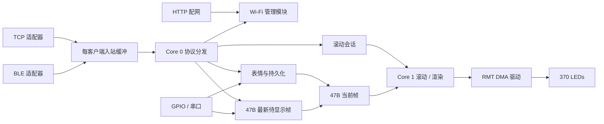

# 固件实际功能、接口与架构审计

审计日期：2026-10-15（America/Toronto）。基线：`8303488c46675121c8a2ebc415d252708439a37f` 加审计开始时的工作区。范围：`esp32s3_firmware/src` 全部 54 个源文件及头文件、`platformio.ini`、主机测试。既有 App/文档修改予以保留；本次没有修改固件、提交代码或刷写设备。

方法：使用 Matt Pocock 的 `codebase-design`、`improve-codebase-architecture`，以模块（module）、接口（interface）、实现（implementation）、深度（depth）、接缝（seam）、适配器（adapter）和删除测试审查。没有创建 issue tracker、ADR 或新框架。功能与架构判断来自当前源码，旧报告只作上下文。

## 1. 结论与判断尺度

固件已有正确主干：**TCP/BLE 两个适配器 → 一个 RinaLink 分发器 → 一份运行状态与滚动时间线 → 一个渲染执行过程 → LED 驱动。** 不需要再增加 controller、repository、event bus 或多级 strategy。

需要优先处理的是接口语义分裂和大对象重复转换：

| 优先级 | 发现 | 证据状态 | 最小处理方向 |
|---|---|---|---|
| P2 / F1 | 通用 `pause` 报告暂停，但固件滚动仍推进 | 生产代码主机复现 | 删除重叠命令，或统一调用现有滚动暂停实现 |
| P2 / F2 | 1500 ms 组滚动经暂停恢复后按 1000 ms 推进，仍报告 1500 | 生产代码主机复现 | 组/本地采用一致的合法间隔规则 |
| P2 / F3 | 无时间线的 `start_scroll` 仍回复 `ok:true` | 生产代码主机复现 | 消费现有 start 返回结果，无时间线明确失败 |
| P2 / A1 | 单帧与控制命令重复回显状态，事件再次发送相同字段 | 回包长度实测 + 静态调用链 | 小 ack；状态由既有状态发布实现负责 |
| P2 / A2 | 表情修改后将同一文档落盘再读回、解析两次 | 静态数据路径确认 | 由已验证文档直接更新缓存 |
| P2 / A3 | bitmap 全量展开后再复制到固定运行时缓冲；协议负责栅格窗口 | 静态大小与调用链确认 | 将时间线准备/提交收回滚动模块，消除固定缓冲复制 |
| P3 / A4 | RuntimeStore 类与全局访问函数两套可变接口，未封装所有权 | 全库调用搜索 | 保留一种访问形式；逐步收回状态写入 |
| P3 / A5 | 固定板型仍维护 Adafruit、RMT non-DMA、RMT DMA 多种构建样式 | 构建配置确认 | 当前产品收敛到 RMT+DMA，退休迁移实现 |
| P3 / A6 | depth=1 的最新帧槽仍保留环形队列参数与空转别名 | 静态确认 | 一个 pending frame，不增加抽象 |

P2 表示可复现的行为错误或确定的重复工作；P3 表示维护复杂度。没有发现足以据此宣称整个固件性能低下的板上时延数据。下面分别列出确定成本和未测量部分。

**“一个功能一个实现”按业务规则归属判断，不按入口数量判断。** GPIO、串口、RinaLink 都调用 `setBrightness()`，属于多个入口复用同一个实现；不是三套亮度实现。HTTP 配网页与 RinaLink 同调 `wifiManager*()`，也是输入适配器，是否移除网页取决于是否保留无 App 配网能力。相反，两个暂停入口写不同字段、两套计时规则采用不同上限，才是应当合并的语义。

## 2. 实际执行与数据所有权



- `main.cpp:97` 的 Core 0 循环顺序：待显示帧 → 可选单核渲染 → Wi-Fi → HTTP → TCP → BLE → 协议 → 滚动结束状态发布 → 状态/设置保存 → GPIO → 串口 → 覆盖动画 → 电源 → 延迟表情恢复 → 自动轮播。
- `scroll.cpp:71` 的 Core 1 任务执行同一 `serviceScrollRender()`，有通知及 1 tick 等待。任务创建失败时 Core 0 调用同一函数，并非第二套渲染实现。
- TCP/BLE 回调只登记客户端、提交字节；`protocol.cpp:2616` 在 Core 0 完成生命周期变更和 blob 释放，避免 BLE 回调直接销毁控制状态。
- 全局锁顺序为 Scroll → Frame → Storage → HardwareBus；Storage 实际同时持有 HardwareBus（`sync.cpp:88`）。这是闪存访问与 LED 发送的现有限制，不能仅因两个锁就判为臭抽象。
- `RuntimeState` 混合控制状态、滚动游标、计数、输出来源和保存标记；调用者仍需知道哪些字段归 Core 0、哪些必须取 Scroll/Frame 锁（`state.h:11`）。这才是封装不足。

## 3. 对外协议接口全表

共 **13 个请求 opcode、6 个主动事件、44 个不同 CMD 名称**。回复 opcode 为请求值 `| 0x80`，错误为 `0xFF`；`SET_FRAME` 回复与 `EV_PREVIEW_SYNC` 共用 `0x90`，`GET_FRAME` 回复与 `EV_STATUS` 共用 `0x91`。请求用序号关联，事件使用 seq=0；固件未禁止请求seq=0，因此客户端必须保留非零请求序号，不能只按type分类。所有请求都由 `protocol.cpp:2250` 的一个 `dispatch()` 分发。

帧结构：6B 头（`A5,type,seq,flags,lenLE16`），payload ≤4096B；`FLAG_MORE=1`。入站flags不参与MORE重组；没有下载完整滚动帧库的opcode。最多 4 个协议槽，TCP 实现最多 2 个连接，另有 BLE 与余量；每槽入站缓冲 4166B（`inbound_frame.h:7`）。

### 3.1 请求 opcode 与实际实现

以下源码位置均在 `esp32s3_firmware/src/`。

| opcode / 接口 | 输入与输出 | 唯一处理实现 | 实际下游 / 约束 |
|---|---|---|---|
| `01 CMD` | JSON `cmd`；字段可位于 payload 或顶层 | `protocol.cpp:1054 handleCmd` | 见下一节；双层参数形式是兼容表面 |
| `02 GET_STATUS` | 可选 `{lite}` → JSON | `:1419 handleGetStatus` | `buildStatusJson`；完整包含 Wi-Fi、矩阵、统计，lite 仍含 power/renderer |
| `03 GET_POWER` | 空 → power JSON | `:1431 handleGetPower` | `addPower` → `readPowerStatusSnapshot` |
| `04 GET_SCROLL_META` | 空 → 元数据及源文本 | `:1438 handleGetScrollMeta` | `scrollSessionCopyMeta`；文本≤4096B，JSON 可跨 MORE 帧 |
| `05 GET_PREVIEW_SYNC` | 空 → 实际锁存帧身份/时间 | `:1524 handleGetPreviewSync` | `buildPreviewSyncJson`、`readLedPresentedSample` |
| `06 PING` | 空 → uptime | `:1530 handlePing` | 直接读取启动时刻 |
| `10 SET_FRAME` | playback u8、reasonLen u8、reason、47B 位图 → JSON ack | `:1548 handleSetFrame` | `takeOverExternalFrame` → `applyPackedFrameQueued`；覆盖固件滚动/自动播放 |
| `11 GET_FRAME` | 空 →47B 二进制 | `:1607 handleGetFrame` | Frame 锁下复制当前帧 |
| `20 BLOB_BEGIN` | kind、totalBytes 与元数据 → chunkMax、offset=0 | `:1616 handleBlobBegin` | `scroll` / `scroll_bitmap` / `faces`；不支持断点续传 |
| `21 BLOB_CHUNK` | offsetLE32 + bytes → offset ack | `:1849 handleBlobChunk` | 检查偏移、长度、generation；写对应暂存内存 |
| `22 BLOB_END` | 可选 `{start}` →提交结果 | `:1970 handleBlobEnd` | 滚动 commit，或校验/保存/重载表情 |
| `23 BLOB_ABORT` | 空 → ack | `:2177 handleBlobAbort` | `resetBlob`，释放暂存及上传独占 |
| `24 GET_FACES` | 可选 offset/gen → genLE32 + 文件片段 | `:2189 handleGetFaces` | generation 防止下载拼接两个文件版本；MORE 后需客户端请求下一 offset |

三种blob的实际输入契约：

| kind | 内容 | 提交实现 |
|---|---|---|
| `scroll` | totalBytes为47倍数，totalFrames≤3072；支持append、时序和timeline/font/generator/sourceText | CHUNK逐帧校验→暂存；END才BeginUpload/BeginAppend→WriteFrames→CommitUpload |
| `scroll_bitmap` | width22..3093、rows18、totalBytes=18×ceil(width/8)；viewportX/virtualWidth须成对，virtualWidth22..200 | END展开47B帧；无viewport时旋转到首个亮帧；再走同一session提交 |
| `faces` | JSON≤256KiB，可为document对象或其外包document字段 | 校验→writeSavedFaces→loadSavedFaces |

raw/bitmap上传共享一份独占slot，30秒不活跃或滚动generation变化时释放；不能把这种真实互斥删除成“无兜底”。BLOB_BEGIN总从offset0开始。TCP建议chunk4032B，BLE为min(2048,8×(MTU−3))；这是传输适配器的差异。

### 3.2 CMD：控制、滚动、表情、设备

表中“入口”指 `protocol.cpp` 行号；“实现”列指定业务规则的归属，不要求再创建对应的类。

| 功能 / CMD | 参数要点 | 入口 | 当前业务实现与审计判断 |
|---|---|---:|---|
| 颜色 `set_color` | hex | 1278 | `led_renderer.cpp setColor`；共享实现 |
| 亮度 `set_brightness` | raw，兼容 brightness | 1280 | `setBrightness`；10..200 限幅 |
| 手动/自动 `set_mode` | mode | 1282 | `faces.cpp setMode` + stop；停止编排部分留在协议 |
| 自动轮播间隔 `set_auto_interval` | ms | 1287 | `faces.cpp setAutoInterval`；500..10000ms |
| 滚动间隔 `set_scroll_interval` | intervalMs 或 fps/uiFps | 1289 | `scrollSessionSetInterval`；本地17..1000ms |
| 开始 `start_scroll` | 时序、可选 sourceText/loop | 1292 | `faces.cpp startFirmwareScroll` → `scrollSessionStart`；F3 |
| 循环 `set_scroll_loop` | loop | 1307 | `scrollSessionSetLoop` |
| 单步 `scroll_step` | direction 按正负归一 | 1309 | session 返回47B，协议组装 presentation 并发布；归属分散 |
| 定位 `scroll_seek` | frameIndex | 1317 | `scrollSessionSeek` 内部发布；与 step 表面不一致 |
| 暂停滚动 `pause_scroll` | 无 | 1319 | `scrollSessionSetUserPaused(true)` |
| 恢复滚动 `resume_scroll` | 无 | 1321 | rewind + `SetUserPaused(false)` |
| 停止滚动 `stop_scroll` | restoreAuto / clear | 1324 | `faces.cpp stopFirmwareScroll` + session stop/延迟恢复 |
| 通用暂停 `pause` | 无 | 1326 | 直接写 RuntimeState；F1，与 session 暂停语义不同 |
| 通用恢复 `resume` | 无 | 1330 | session 恢复 + 直接重写 playback；与上述重叠 |
| 显示表情 `apply_saved_face` | id 优先；否则 index；reason/playback | 1336 | 查找、stop、manual、`faces.cpp applySavedFaceIndex`；id/index 分支重复接管步骤 |
| 逻辑按钮 `button` | button | 1381 | `buttons.cpp runButtonAction`；亮度键保留组时序 |
| 终止其他活动 `terminate_other_activities` | targetMode | 1392 | stop + setMode；现有控制动作组合，适合随客户端调用一起收敛 |
| 重置电池下限 `reset_battery_min` | 无 | 1395 | `power_monitor.cpp resetBatteryVoltageMinimum` |
| 重置电池上限 `reset_battery_max` | 无 | 1397 | `resetBatteryVoltageMaximum` |
| 电量覆盖 `battery_overlay` | singleShot | 1399 | `button_animations.cpp showBatteryOverlay` |
| 设备能力 `get_info` | 无 | 1081 | `handleGetInfo`；固件、身份、堆、caps、bootId |
| 时钟样本 `clock_sample` | 无 | 1087 | 收到/发送的 esp_timer 时间与 bootId；组同步真实需求 |
| 板号覆盖 `identify` | number1..9、ttlMs0..30000 | 1098 | `setIdentifyOverlay`；0取消，覆盖层超时独立于连接 |
| 组开始/重锚 `group_start` | bootId、atUs u64、startFrame、intervalMs17..2000、loop | 1117 | `scrollSessionGroupStart` → `group_math::groupCursorAt`；与本地共享帧库，时序上限分裂 F2 |
| 重启 `reboot` | 无 | 1163 | 延迟200ms，serviceProtocol 调 ESP.restart |
| 订阅 `subscribe` | preview/status/power/log | 1171 | 每客户端订阅字段 |
| 日志订阅 `log_subscribe` | on | 1171 | 与 subscribe.log 同一实现，重复命令表面 |
| 改设备名 `set_device_name` | name，空恢复默认 | 1210 | BLE transport 校验/广播更名 + storage 保存；身份修改归属于 transport，职责位置值得收回 |
| 悬停提示 `set_hint_led` | led/mirror -1..369 | 1238 | `setHintLed`；仅 control 输出、按连接槽清理 |
| 表情重命名 `face_rename` | id/name | 1189 | `handleFaceRename` → `mutateFacesDocument` |
| 表情排序 `face_reorder` | ids | 1193 | `handleFaceReorder` → 同一 mutate 内核 |
| 删除表情 `face_delete` | id | 1197 | `handleFaceDelete` → 同一 mutate 内核 |
| 新增/替换表情 `face_upsert` | face；支持 frameHex 或 frameBytes | 1201 | `handleFaceUpsert` → 同一 mutate 内核；两种输入表示但一个保存路径 |
| 清用户表情 `faces_clear_user` | 无 | 1205 | `handleFacesClearUser` → 同一 mutate 内核；保留默认表情 |

### 3.3 CMD：Wi-Fi

| CMD | 入口 | 唯一业务实现 |
|---|---:|---|
| `wifi_status` | 553 | `wifiManagerGetStatusJson` |
| `wifi_scan` | 557 | `wifiManagerStartScan`，回复 scanning；完成事件另外发 |
| `wifi_scan_result` | 574 | `wifiManagerGetScanJson`，可轮询当前扫描状态 |
| `wifi_set_credentials` | 581 | `wifiManagerSetCredentials`，home 配置 |
| `wifi_clear_credentials` | 588 | `wifiManagerClearCredentials`，TCP延迟无线变更 |
| `wifi_set_hotspot_credentials` | 593 | `wifiManagerSetHotspotCredentials` |
| `wifi_clear_hotspot_credentials` | 600 | `wifiManagerClearHotspotCredentials`，TCP延迟无线变更 |
| `wifi_set_mode` | 605 | `wifiManagerSetMode`，off/ap/sta/sta_or_ap |
| `wifi_connect` | 612 | `wifiManagerConnect` |
| `wifi_set_ap` | 617 | `wifiManagerSetAp`；TCP中拒绝会改变当前AP地址的操作 |

home/hotspot 是两个实际凭据档案，共用一次扫描与选择过程，不是两个 Wi-Fi 实现。默认板身份由 `board_identity.cpp` 的 MAC 派生，AP 地址由 `ap_address_policy.h` 计算/验证，NVS 可覆盖。

### 3.4 主动事件

| 事件 | 实现 | 实际调度 |
|---|---|---|
| `90 EV_PREVIEW_SYNC` | `buildPreviewSyncJson` | presentation seq 改变时；BLE最多4Hz，TCP最多10Hz |
| `91 EV_STATUS` | `buildStatusJson(lite=true)` | version改变；发送间隔≥200ms |
| `92 EV_POWER` | `addPower` | 每1000ms或充电状态翻转；与 STATUS.power 重复携带 |
| `93 EV_WIFI` | `wifiManagerGetStatusJson` | 状态改变；每客户端 pending，发送成功再清 |
| `94 EV_LOG` | log sink →16条环形缓冲 → fan-out | 默认不订阅；每客户端重复构造JSON |
| `95 EV_WIFI_SCAN` | `wifiManagerGetScanJson` | 优先请求者，否则广播；未发出保留pending |

状态快照和 LED 锁存样本描述不同事实，不能把所有 preview 信息删掉。应明确“控制状态”和“已显示时刻”各自事实来源，去除无意义字段重叠，而非强制所有遥测同频。

## 4. 其他实际入口与内部功能清单

### 4.1 HTTP 与 BLE GATT

HTTP 路由只有配网，没有第二套显示控制网页实现（`web_setup.cpp:357`）：

| method / route | handler | 实际业务实现 |
|---|---|---|
| GET `/` | handleRoot | 内嵌配网页 |
| GET `/api/wifi/status` | handleStatus | wifiManagerGetStatusJson |
| POST `/api/wifi/scan` | handleScanPost | wifiManagerStartScan |
| GET `/api/wifi/scan` | handleScanGet | wifiManagerGetScanJson |
| POST `/api/wifi/credentials` | handleCredentials | 保存home、回复后切 sta_or_ap 并 connect |
| POST `/api/wifi/hotspot` | handleHotspot | 保存hotspot |
| POST `/api/wifi/mode` | handleMode | wifiManagerSetMode |
| POST `/api/wifi/ap` | handleAp | wifiManagerSetAp；此入口不接收ip |
| 其他路径 | handleNotFound | JSON 404；DNS将 rina.io 解析到 AP |

HTTP 入口与 RinaLink 操作步骤不完全相同，尤其 credentials 自动连接，而 RinaLink 分开操作；mode/AP 回复前可能改变无线状态。`WebServer::handleClient()` 仍是 Core 0 同步工作，配置将部分等待降为200ms，不能据此承诺整次请求总耗时≤200ms。

BLE 是同一协议的 GATT 适配器：RX接收write/write-no-response字节，TX按MTU分片notify，INFO可读设备/协议信息（`transport_ble.cpp:678`）。INFO不另行实现控制逻辑。客户端订阅、初始化超时、广告恢复归 transport；`ble_frame_sender.h` 与 `tcp_frame_sender.h` 是确有不同传输约束的发送实现，不应合成一个复杂的通用重试器。

### 4.2 串口与硬件按钮

| 入口 | 实际实现 | 说明 |
|---|---|---|
| 串口 help/status | `serial_console.cpp printHelp/printStatus` | 文本诊断；不应算第二套生产状态模型 |
| frame clear / frame hex | 接管输出 → `applyBlankFrame` / `applyPackedFrameQueued` | hex94字符，47B；复用 renderer |
| btn / color / bright | `runButtonAction` / `setColor` / `setBrightness` | 共享业务实现 |
| log on/off/level | `serial_log.cpp rinaLogSet*` | 运行时诊断开关 |
| GPIO B1/B2 | `buttons.cpp runButtonAction` →相对表情 | 下一张/上一张；B2可按住重复 |
| GPIO B3 | `toggleModeFromButtonAction` | 自动/手动 |
| GPIO B4/B5 | `adjustBrightnessFromButton` →setBrightness | 降/升8；不退出组时序 |
| GPIO B3+B1/B2 | `adjustAutoIntervalFromButton` →setAutoInterval | 减/增500ms |
| GPIO B1长按10秒 | `bleTransportFactoryReset` | 清设备名，物理操作 |
| GPIO B6长按10秒 | `wifiManagerFactoryReset` | 清Wi-Fi NVS，恢复AP |
| GPIO B6及组合输入 | `button_animations.cpp serviceButtonAnimationButtonInputs` | 电量覆盖、按键动作反馈；B6不是普通 runButtonAction 分支 |

### 4.3 内部模块的真实职责

| 功能 | 对调用者的现有接口 | 实现归属 | 判断 |
|---|---|---|---|
| 初始化与调度 | setup / loop | main.cpp | 保留简单编排 |
| 状态存储与version发布 | runtime* / touchRuntimeState* | state.cpp | 两套可变访问表面；A4 |
| 直接/排队应用帧、参数变更 | applyPackedFrame* / setColor / setBrightness | led_renderer.cpp | 一套帧发布规则；step/tick部分穿透 |
| 映射、提示/identify/动画合成 | renderCurrentFrameToLedStrip | led_renderer.cpp | 输出优先级 identify > hint > button overlay > content |
| 物理GRB/亮度/RMT输出 | leddrv::* | led_driver.cpp | 固定产品可保留一个实现；硬件适配器有实际深度 |
| 滚动元数据、上传、暂停、游标 | scrollSession* | scroll_session.cpp | 接口较宽；写状态规则应集中于此 |
| 滚动执行任务 | startScrollRenderTask / serviceScrollRender | scroll.cpp | 实际跨核调度，不是应删除的空转模块 |
| 组窗口/绝对时间游标 | group_math::* | group_math.h | 无状态计算，不应机械挪回协议 |
| 表情选择、自动轮播、恢复 | setMode / applySavedFace* / serviceAutoPlayback | faces.cpp | 有实际实现；协议中的接管编排应收回 |
| 文件与运行设置 | mount/read/write/load/save | storage.cpp | atomic tmp+rename；表情二次解析A2 |
| GPIO去抖、连发、组合键 | serviceHardwareButtons / runButtonAction | buttons.cpp | 物理与逻辑动作共享实现 |
| 动画与电量/重置反馈 | service/copyButtonAnimationOverlay | button_animations.cpp | 多个反馈效果是不同功能，不是同功能多套样式实现 |
| ADC采样、断电/充电判定 | servicePowerMonitor / snapshot | power_monitor.cpp | 周期分步ADC采样；启动强制采样同步 |
| 电压自校准 | batteryCalib* | battery_calibration.cpp | 纯规则与硬件/NVS隔离有实际测试价值 |
| Wi-Fi凭据/扫描/STA/AP/mDNS | wifiManager* | wifi_manager.cpp | 一套管理状态机，JSON也被内部读取 |
| 身份与AP地址 | boardId/boardBootId、apIP/factoryApIP、address policy | board_identity.cpp/config.cpp/ap_address_policy.h | 板号与地址规则集中，保留 |
| 跨任务互斥 | ScopedLock / with*Lock | sync.cpp/h | 真实并发约束；不等同多余业务分层 |
| 结构化日志与USB/UART输出 | RLOG_* / rinaSerial* | serial_log.cpp | EV_LOG与串口是投递目的地，不是两套业务 |
| 字符/颜色/位图辅助 | utils::* | utils.cpp | 现有小函数；不据文件小就批量合并 |
| PSRAM JSON分配 | PsramJsonDocument | psram_json.h | 可删除固定产品的大对象internal-heap回退；不是再加allocator策略 |
| SDK IPC任务栈调整 | __wrap_xTaskCreatePinnedToCore | ipc_stack.cpp | 现有链接适配，针对ipc0/ipc1，不属于业务接口 |

[公开函数逐项索引](audits/2026-10-15-firmware-architecture/public-interfaces.csv) 包含216条头文件自由函数声明、位置与定义位置；不含类内方法、inline模板和宏。多条定义包括编译互斥分支，不能按源码匹配数认定运行时多实现。[源文件清单及SHA256](audits/2026-10-15-firmware-architecture/source-manifest.csv) 用于确定审计版本。

## 5. 已复现的接口语义问题

### F1：暂停状态与实际播放分裂（P2）

[protocol.cpp:1326](../esp32s3_firmware/src/protocol.cpp#L1326) 的 `pause` 只写 `paused=true/playback=paused`。滚动 tick 在 `scroll_session.cpp:647` 检查 `firmwareScrollActive/firmwareScrollPaused`，不检查这个 paused。复现：启动滚动→通用pause→推进1500ms→游标从0到1，状态仍表示暂停。

这不是增加一个 paused 兜底检查就结束的问题。最小方向是去掉重复语义：统一暂停由既有 scroll session 实现拥有；若通用暂停还用于自动轮播，则只在一个业务入口里选择当前活动的暂停规则。不要保留两套会不同步的“成功”。

### F2：组时序退出后采用另一套上限（P2）

`protocol.cpp:1135` 接受17..2000ms；`scrollSessionGroupStart()` 原样保存1500ms，组tick原样使用。`pause_scroll/resume_scroll` 会退出groupTimed，保留 `scrollIntervalMs=1500`；本地tick却在 [scroll_session.cpp:696](../esp32s3_firmware/src/scroll_session.cpp#L696) clamp到1000。复现输出：`reported_interval_ms=1500 actual_advance_after_ms=1000`。

应由一个位置规定支持范围，接管时显式采用同一规则；不要让tick隐藏修改行为。是统一到1000还是2000需与当前客户端合法输入一致，本次不擅自修改协议。

### F3：启动失败被当成成功（P2）

[protocol.cpp:1306](../esp32s3_firmware/src/protocol.cpp#L1306) 忽略 `startFirmwareScroll()` 的bool返回值，进入统一成功回复。空时间线时session没有开始，客户端仍收到 `ok:true`。`group_start` 已有 `409 no_timeline`，说明无需另造错误机制。

`scroll_seek/scroll_step` 的bool也被当作no-op处理，没有区分空时间线与成功操作（`:1309`、`:1317`）。已复现的是start，另两项属于同一接口契约的检查点，未将其伪称为已测错误。

## 6. 数据传递与性能成本

### A1：控制回包与状态广播重叠（P2，Strong）

`reply()`（`protocol.cpp:530`）回显颜色、亮度、模式、表情、滚动等；`handleSetFrame()`（`:1584`）也回显渲染状态。之后 `EV_STATUS`、`EV_POWER`、`EV_PREVIEW_SYNC` 再重复一部分字段；事件JSON还在每个客户端循环里重建。

主机实测：普通亮度命令回复637B；空reason的单帧请求payload49B、回复297B。假设此样本连续30fps，回复payload为8910B/s，请求payload1470B/s；不含协议头/ATT/TCP开销，不是板上带宽测量。`DynamicJsonDocument out(2048)` 是内存容量，不能说每条CMD固定返回2KB。

先让高频操作返回最小ack与必要关联字段；状态由已有builder/event负责；需要读回结果的命令仅返回该结果。之后可在一次fan-out中构建共享快照/序列化结果。保留首连GET快照与不同频率的presentation/power事件；无需增加通用事件框架，也无需把所有事件硬合成一个巨型状态包。协议与客户端需同改。

### A2：表情文档往返闪存（P2，Strong）

当前修改路径：

```text
LittleFS → 文件缓冲 → JsonDocument A → mutate/validate
  → 全量String → tmp文件/rename
  → LittleFS → 文件缓冲 → JsonDocument B → RuntimeFace缓存
```

`protocol.cpp:690/699/721/726` 与 `storage.cpp:126/342/353`。A在B解析期间仍存活；即使只改名字，也对整库做两次读盘/解析，写入还生成完整String。上限为256KiB JSON、128个表情；实际heap占用取决于JSON结构，不能把文档容量直接当作实际文件大小。

最小改动是把“已验证文档→RuntimeFace缓存”的现有循环放到storage内部，启动加载和修改后各调用它；修改后直接用A，取消B的读回。写入直接流向tmp文件并核对字节数，可去掉完整String。保留完整写入检查和rename；不增加Repository/DTO/mapper链。验证目标是改名/排序后的gen、当前表情ID、下一次轮播与重启读回一致。

Storage锁持有HardwareBus，故大文件操作可阻挡LED refresh；尚未测量最长阻塞，不能声称已确认掉帧。

### A3：滚动格式与全量缓冲复制（P2，Strong）

现有两条实际实现：raw47B帧上传（含append），bitmap上传（含viewport）。它们最终都进入同一个scroll session；这不是两套播放引擎，但确实维护两套上传格式/校验/提交路径。

```text
raw: 入站 → scrollBuf暂存 → session固定帧库
bitmap: 入站 → bitmapBuf暂存 → 协议展开stagingBuf → session固定帧库
```

`protocol.cpp:1641/1708/2064/2106`，`scrollSessionWriteFrames()`。最大固定帧库 `3072×47=144384B`；最大单板bitmap `18×ceil(3093/8)=6966B`，对应3072帧。提交前bitmap+staging+固定库的像素数据共 **295734B**，还未计文本、JSON、客户端缓冲与对象。raw满库暂存+固定库为288768B。

全量展开最多约 `3072×370=1136640` 次像素采样，在Core 0同步执行。每256帧的 `vTaskDelay` 让调度器运行其他任务，但不会让尚未返回的Core 0 loop去服务下一条协议/按钮输入。没有实测展开耗时，不能称其免费或给出虚构fps收益。

事务性暂存有真实用途：传输失败不能摧毁当前时间线。**不要为省一次复制直接覆写正在播放的帧库。** 最小深度改进是让滚动模块拥有准备、展开和提交过程，成功后把已准备缓冲作为新时间线移交所有权，而非再复制进固定库；先消除确定的整库复制，不添加后台job/消息总线。

产品若只需当前文字滚动与组viewport，bitmap足够表达；raw/append可在确认生产调用并随客户端统一发布时删除。本次仅确认固件支持它们，未全审App调用，不把“当前无人使用”当成事实。不要直接改为每tick从bitmap现算：那是改变存储模型与实时负载的另一项设计，需独立验证，不作为本次默认方案。

### 同步发送仍占用Core 0

`tcp_frame_sender.h:17`、`ble_frame_sender.h:180` 都是每个完整帧最长250ms的同步发送过程（部分已发事件也必须完成或断开，不能从字节流中途丢弃）。协议每客户端每pass最多处理8个入站帧，限制了条数，没有限制整个pass的总时间。多帧JSON的deadline也按每帧重新开始；不能把250ms当作整个控制循环的上限。

因此ACK越大，BLE分片/背压越容易占用串行控制循环，影响按钮、后续命令和主循环任务；Core 1只能保护渲染执行，无法替Core 0处理输入。先缩小回包、去掉重复序列化，再用真实链路测控制延迟；当前不据此引入独立网络任务或多级队列。

### 小帧跨核复制不是首要热点

每个滚动tick：帧库→nextFrame47B→当前帧47B→renderer快照47B，约141B/tick；60fps约8460B/s。随后将370个位转换成1110B GRB。Frame快照使锁外硬件输出拥有稳定数据；GRB是数据表示转换，不是无效DTO搬运。

`copyButtonAnimationOverlay()` 只快照小型动画状态后绘制到输出缓冲，并非缓存两份1110B再复制。相比之下，整库文档、全时间线暂存和冗余JSON才值得先动。

## 7. 过浅模块、多样式与不必要兜底

### A4：状态接口没有获得封装深度（P3，Strong）

`RuntimeStore::instance().state()/frameBits()/scrollMeta()` 再由 `runtimeState()/runtimeFrameBits()/runtimeScrollMeta()` 原样转发（`state.h:127`、`state.cpp:75`）。生产class调用只在这些转发中。删除class这层时复杂度不会重现到调用者，属于shallow module。

最小处理：保留现有全局接口，把存储置于state.cpp私有作用域，去掉等价class/getter外壳。更关键的是让scroll session拥有滚动状态写入，让renderer拥有帧发布；避免进一步增加可变getter。step应像seek一样内部完成帧与presentation发布，协议无需了解两者顺序。当前step先暂停后发布，未证明其已导致帧/context竞态，不将结构问题说成数据损坏。

### A5：固定产品可退休的实现和回退（P3，Strong / Worth exploring）

- `platformio.ini:5` 当前默认是RMT+DMA。`led_driver.cpp:51` Adafruit与`:95` RMT编译互斥，另有non-DMA/verbose环境。它们不会同时消耗每帧CPU；不是运行时自动切Adafruit。
- 按用户“一种功能不保留多种样式”的目标，当前板固定为ESP32-S3+OPI PSRAM时，可退休Adafruit实现、依赖及non-DMA迁移环境；保留一个 `leddrv` 硬件适配器，因为编码、GRB、亮度、ISR与完成语义确实需要集中实现。
- 大对象PSRAM失败后回退internal heap，散落于state、blob、JSON allocator；仅固定时间线就144384B（`state.cpp:39`）。固定8MB PSRAM产品更清楚的契约是大对象必须在PSRAM，失败明确返回现有507/初始化失败，不靠吃internal SRAM维持表面成功。小型控制对象不必机械套此规则。
- RMT初始化候选默认2046后再次尝试2046（`led_driver.cpp:272`），以及多级缓冲降级，可随固定硬件配置收敛；并无“保证一定能初始化成功”的事实，候选全失败仍返回false。应删除重复尝试与过度承诺。
- RMT发送超时后停用/排空/重置（`:360`）是ISR仍持有sPixels的真实所有权处理，不能当作冗余兜底删除。原子文件提交、generation、合法长度校验、TCP部分写关闭、BLE已发部分不能丢弃，同样有明确失败场景。

### A6：单槽仍用环形队列表面（P3，Strong，低收益）

`config.h:133` depth=1；`led_renderer.cpp:180` 每次覆盖target0、head0、count1，消费仍做head/modulo（`:465`）。实际需求就是最新帧待显示槽。保留一个47B帧结构和pending标记，删除head/数组/modulo；保留限速、覆盖、丢弃统计。

`showCurrentFrameNoLock()`（`:212`）只调用 `requestLedRender()`，可直接用真实接口。此项主要改善可读性，不能包装成显著性能优化。

## 8. 建议的收敛顺序与最小目标

1. **先修语义**：F1/F2/F3。直接通过现有协议接口补组合回归；不新建架构。成功标准是暂停真实停止、状态间隔等于游标间隔、没有时间线明确失败。
2. **再减数据工作**：小ack，表情修改直接重建缓存。每项集中在一个现有模块，验证客户端必要字段与文件一致性。无需先拆protocol.cpp到多级handler目录。
3. **再收回滚动所有权**：协议只负责字节/命令校验与应答，scroll session拥有上传准备、展开、提交、播放及帧身份；复用现有renderer的原子发布。提交移交准备缓冲，删除整库复制。
4. **最后删迁移包袱**：固定产品RMT+DMA、大块内存PSRAM契约、单槽状态、重复别名。协议别名/raw路径需核对生产客户端并同改。

最小目标是 **输入适配器 → 现有业务模块 → renderer/driver**，而不是“输入→command DTO→use case→service→repository→adapter”。选择A能直接解决时，不增加B/C/D。没有实际变化点就不设strategy；同一规则只在一个实现里决定，调用者不重复编排。

## 9. 验证、证据与限制

- 现有17个Python主机测试、5个独立C++主机测试全部通过；[Python结果](audits/2026-10-15-firmware-architecture/host-python-results.tsv)、[C++结果](audits/2026-10-15-firmware-architecture/host-cpp-results.tsv)。部分测试是抽取函数/静态断言，不能等同板上全功能通过。
- [审计复现脚本](audits/2026-10-15-firmware-architecture/reproduce_findings.py) 用现有stress fakes链接未改的生产translation units，并启用ASan/UBSan；[复现输出](audits/2026-10-15-firmware-architecture/reproduced-findings.txt) 证明F1/F2/F3及回包大小。此脚本断言的是当前缺陷，修复后应转成期望行为的回归测试，不能把exit0解释为这些功能正确。
- 复现命令：`python3 docs/audits/2026-10-15-firmware-architecture/reproduce_findings.py`。依赖本机C++编译器及已安装的 `.pio/libdeps/esp32s3-rmt-dma/ArduinoJson/src`，不下载依赖，不访问板子。
- 默认生产环境完整编译未完成：PlatformIO在 `Scanning dependencies...` 停留约5分钟，未观察到编译调用，已中止本次构建。不是已确认的源码编译错误，也不宣称编译通过。[构建摘要](audits/2026-10-15-firmware-architecture/build-summary.txt)、[日志](audits/2026-10-15-firmware-architecture/build.log)。
- 本次没有板上帧率、heap峰值、长尾控制延迟、功耗或Wi-Fi/BLE吞吐测量。字节数量是确定的源码/主机证据，性能改善幅度未测。
- Grok 4.7负责有界只读协议入口提取；GPT-6.1 Sol负责独立渲染/状态审查；主审对决定性结论逐项核实并执行复现。最终取舍不以其他模型的意见代替源码证据。

可视化候选报告：`/tmp/architecture-review-20261015-064245.html`。默认浏览器无可用文件关联，应用内浏览器禁止file协议，故未完成浏览器预览；本文保留实际执行图及全部文字结论。HTML是补充视图，不影响审计证据。
