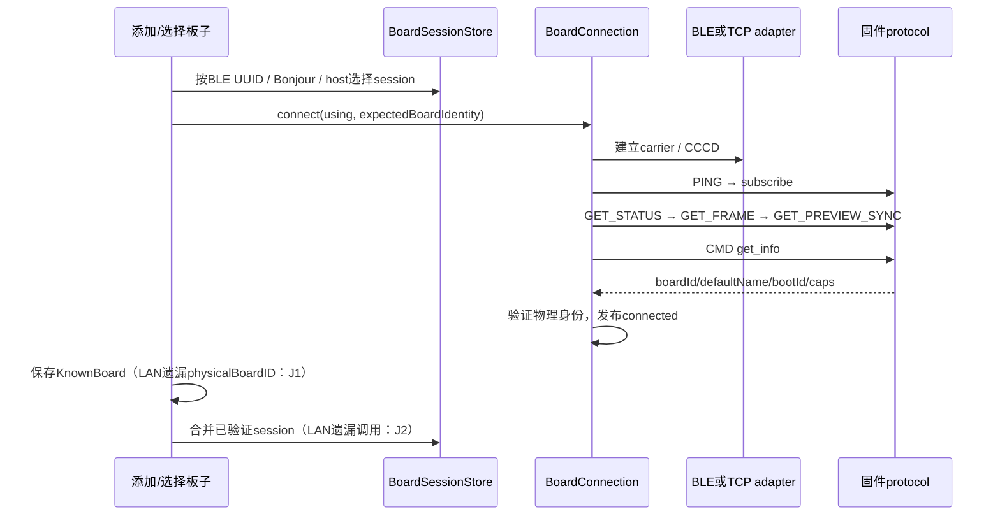
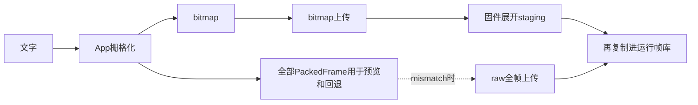

# 固件与 iOS 联合连接、协议及数据流审计

日期：2026-10-15（America/Toronto）。基线：`8303488c46675121c8a2ebc415d252708439a37f` 加当前工作区。对照 [固件审计报告](FIRMWARE_INTERFACE_ARCHITECTURE_AUDIT_2026_10_15_ZH.md)，重新检查当前修改后的 iOS，而非将旧结论原样复制。方法采用 Matt Pocock `codebase-design`、`improve-codebase-architecture`；iOS 部分同时采用 `ios-dev` 的所有权与并发检查。

本次只新增联合报告和证据，不修改产品源码、不刷机、不提交代码。审计范围是连接入口、会话身份、BLE/TCP、请求/应答、状态、文字滚动、组控制及相关测试，不是对所有 iOS 界面再做一次全面审计。

## 1. 联合结论

两端的基础协议对得上：**44 个 CMD 名称一致，13 个请求 opcode 与 6 个事件一致；帧格式、47B 位图、GATT、TCP 端口、组时钟契约均有对应实现。** 问题主要是 iOS 没有把固件已经提供的身份信息贯穿“连接成功→保存→会话合并→下次恢复”，以及两端重复准备/回传相同数据。

| 编号 | 级别 | 问题与实际触发 | 分类 / 证据 |
|---|---|---|---|
| J1 | P2 | 首次LAN保存不带物理身份；手动地址被另一块板复用后，冷启动可把它当成原板 | 既有问题；两端调用链确认 |
| J2 | P2 | 添加板子的LAN成功入口遗漏session合并；同板BLE/LAN保持两份session，LAN侧缺少已知BLE地址 | 既有问题；入口与实现接线确认 |
| J3 | P2 | 4096B源文本合法，不代表携带它的BLOB_BEGIN JSON≤4096B；栅格化接受后上传前拒绝 | 两端元数据/帧限制不一致；主机探针 |
| C1 | P2 | 固件状态回包与事件重复；直接改成所有命令统一小ack又会影响iOS组表情解析 | 确定的联合改动约束，不能单端删字段 |
| C2 | P2 | App全时间线与bitmap并存，固件再展开/复制；raw回退只覆盖部分不一致 | 真实双格式维护和全量数据成本 |
| C3 | P3 | 建连握手读完状态/预览，UI恢复又立即读同样两项 | 真实重复请求；前台恢复仍需新读取 |
| C4 | P3 | 一个CMD有多个执行入口，组扇出隐含于普通command；同一命令的排队/扇出规则取决于入口 | 接口复杂度；不是六套wire实现 |

J1/J2最先处理。它们不需要修改固件协议，不需要新增连接管理模块：既有身份字段和合并实现已经存在，缺的是调用它们。

**当前diff内未确认新引入的连接协议回归。** 这不等于整份iOS改动已全部正确；本报告覆盖的是下列连接与交互范围。

## 2. 新 iOS 改动到底改变了什么

以本次 `git diff HEAD` 为准，[改动清单](audits/2026-10-15-firmware-ios-joint/ios-diff-stat.txt) 与 [连接范围diff](audits/2026-10-15-firmware-ios-joint/connection-scope-diff.txt) 已保存。

| 修改区域 | 当前实际变化 | 对联合审计的含义 |
|---|---|---|
| `BoardConnection.swift` | 重连失败/命令拒绝等提示本地化 | 没有改写请求关联、输出租约或重连算法；J1/J2不是此diff引入 |
| `BLETransport.swift` | 蓝牙不可用、未选板、通知失败等文案本地化 | 没有改CCCD、MTU、背压、watchdog握手 |
| `BoardSessionStore.swift` | 默认板名本地化 | 没有改变session创建/合并/备用carrier策略 |
| `WatchLinkService.swift` | 预设显示名本地化 | 没有改变发给固件的颜色值或命令字段 |
| `RinaMacWiFiBridge.swift` | 错误文案调整 | 不构成新的Wi-Fi协议实现 |
| `RootTabView`、Control Center、Duo界面 | 控制中心从系统附属条/弹层改为菜单卡片，布局与呈现同步调整 | 需按当前入口追踪连接；不能据UI重排声称重连已重构 |
| `BootLoaderModel` | DEBUG模拟器最短显示时长控制 | 生产构建仍用原最短显示，不是固件连接超时变更 |
| `GroupScrollPreview` | 成员状态统一行高、单行显示 | 未修改组时钟/上传协议 |
| 连接与输出测试 | 本地化期望值及界面相关断言更新 | 已有mock测试通过仍不代表遗漏的LAN入口被覆盖 |

本仓库实际没有 `RinaLinkSession` 或 `transportGeneration` 模块/字段。当前实现是 `BoardConnection` + `RinaRequestBroker`，以及 `transportSessionID` / `connectionGeneration`。后文均按实际名称描述。

## 3. 两端实际连接链路



- 固件身份来自 `board_identity.cpp` 的BT MAC派生值；`protocol.cpp:421` 的GET_STATUS携带wifi.boardId，`:642` 的get_info携带defaultName/bootId/caps。
- iOS在 [BoardConnection.swift:348](../ios/RinaBoard/Services/BoardConnection.swift#L348) 等待协议PING后继续读取，`:389` 起形成candidateIdentity；若传入expectedBoardIdentity则核对后才发布connected。
- BLE必须完成GATT发现和TX通知启用。固件的初始化超时直到首个完整入站请求才确认；因此“CCCD就绪→PING→ready”具有实际用途，不能删成直接相信系统连接回调。
- `transportSessionID`隔离旧carrier回调；`connectionGeneration`隔离旧功能操作；输出租约隔离同一连接上被替换的生产者。三个标记保护不同生命周期，不能仅因都是UUID就强行合并。
- 断线后的尝试排序由BoardConnection拥有；BoardSession提供同板候选地址。BLE/TCP确有不同硬件约束，是必要adapter，不是重复业务实现。

## 4. 已确认的连接问题

### J1：有身份能力，首次LAN保存却没有使用（P2，Strong）

**固件端：**当前固件已稳定提供每板唯一身份，并不要求通过IP推测板子。iOS握手也已经解出了 `connection.boardIdentity`。

**iOS端断点：**

- [ConnectionViewModel.swift:357](../ios/RinaBoard/Features/Connection/ConnectionViewModel.swift#L357) 的Bonjour成功保存，以及 [:387](../ios/RinaBoard/Features/Connection/ConnectionViewModel.swift#L387) 的手动host成功保存，构造KnownBoard时均未传physicalBoardID。
- `BoardStore.swift:45` 的该参数默认nil；存储模块无法替调用者凭空恢复已验证身份。
- 冷启动/已保存板重连在 `ConnectionViewModel.swift:772` 仅从physicalBoardID或热点SSID派生expectedBoardIdentity。手动LAN记录两者都没有时，已有的身份检查失去expected参数。
- 到`:884`连接成功后才补写physicalBoardID；如果连接到的是另一个板，这时补写的是另一个板的身份。

**触发链：**手动host连接A→首次保存记录没有physicalBoardID→退出App→该host/IP现在对应B→恢复保存记录→PING/状态成功且没有expected限制→B被接受，记录改写为B。Bonjour的每板唯一service名通常减少地址复用风险，但仍存在相同的身份登记遗漏；不把“普通Bonjour DHCP变化必连错板”当成事实。

**最小收敛：**所有成功保存路径使用握手已验证的同一份身份；复用KnownBoard/BoardStore字段。删除测试：把每个入口的零散身份登记收回现有连接完成过程，调用者少记规则，复杂度集中；无需新建IdentityRepository。

**应补的接口测试：**通过生产 `connectManualHost` 成功保存A→重新创建连接/存储并恢复→模拟host返回B→必须在ready前拒绝。现有expected身份测试只证明“传入时会验证”，没有证明“首次保存入口确实传下去了”。

### J2：LAN成功入口未接上现有session合并（P2，Strong）

**断点：**[AddBoardView.swift:198](../ios/RinaBoard/Features/Connection/AddBoardView.swift#L198)、[:217](../ios/RinaBoard/Features/Connection/AddBoardView.swift#L217) 选择/创建LAN session后只连接；BLE入口`:140`会调用 `consolidateVerifiedSession`，热点入口也有合并。LAN两条路径没有。

**实际影响链：**

1. A先通过BLE连接，session记住BLE UUID。
2. 添加页再用A的Bonjour/host连接。新id尚无alias，`BoardSessionStore.swift:200` 创建第二session；`select()`使非组拥有的旧session输出租约失效，旧carrier保留；组拥有的输出租约也保留。
3. 固件支持同板多客户端，不会替App合并这两个session；两条连接各自订阅并收到状态。
4. LAN掉线时，备用候选只搜索该session自身BLE对象和aliases（`:85`），无法使用另一session已知的BLE UUID。组成员解析遇到两个同物理身份的connected session也按列表顺序选择，未必是当前选中的LAN session。

既有 `consolidateVerifiedSession`（[BoardSessionStore.swift:255](../ios/RinaBoard/Services/BoardSessionStore.swift#L255)）已能合并alias/已验证endpoint、断开重复carrier、删除重复session。最小改动是在验证成功的LAN路径调用它；不新增第四套重连逻辑。合并方法本身不需要再包一层管理器。

**应补测试：**走实际添加/连接完成路径完成BLE→同板LAN，断言只剩一个session、别名含BLE UUID、旧carrier停止；随后LAN失败时候选仍能选BLE。现有直接调用合并方法的测试，只证明实现存在，没有验证入口接线。

### J3：文本预算与元数据帧预算是两个不一致的接口（P2，Strong）

- App `ScrollText.swift:10`、固件 `config.h` 都允许源文本4096B。
- `BoardConnection.swift:1471` 将sourceText与width、fps、timelineId等放进BLOB_BEGIN的同一个JSON；`uploadBlob:1310` 对整个编码payload执行4096B校验。
- 固件 `inbound_frame.h:9` 也只允许每帧payload4096B，且入站MORE不聚合请求；不能靠给BEGIN加MORE绕过。

因此源文本本身合法，不代表这个完整请求合法。审计探针采用一个可见A和1365个ZWJ（4096 UTF-8字节），生产栅格化器会过滤格式控制并生成很短时间线，排除了“先超帧数”的混淆；随后同形BEGIN元数据为4322B，超过4096B并被编码器拒绝。它是边界用例，不代表常见短文本都会失败。

最小方向是给“完整BEGIN”定义一个一致的预算，由已有上传模块在生成前/生成时执行同一规则并向UI报告；不能只检查sourceText字节。若产品确实要支持任意4096B源文本，就必须调整它的传输位置与两端实现，而不是再加raw兜底，因为raw BEGIN也携带同一文本。无须新增三种文字上传策略。

## 5. 对原固件报告的逐项联合复核

| 原编号 | 固件结论 | 当前iOS实际可达性 | 联合判断 |
|---|---|---|---|
| F1 通用pause不暂停scroll | 仍成立，固件未变化 | TextViewModel:576使用pauseScroll；:582使用resumeScroll。未发现正常生产发送通用pause/resume的调用，RinaCommand定义保留它们 | 潜在wire/调试问题，不能称当前文字暂停按钮已坏；可随两端删无调用命令 |
| F2 1500ms组退出变1000 | 仍成立，原探针有效 | UI速度1..60fps，生产interval计算范围17..1000；组恢复重新group_start。1500ms由底层/调试可构造，正常UI不产生 | 现有协议域不一致；优先级低于J1/J2，不是当前组UI必现 |
| F3 空时间线start返回成功 | 仍成立 | 正常文字用BLOB_END(start=true)，组用group_start；未发现生产调用RinaCommand.startScroll | 不能由此断言App发送文字后显示成功但没播放；底层遗留命令仍需收敛 |
| A1 回包重复状态 | 成立 | App解码CommandReply；组表情路径消费autoFaceId/Index或退到GET_FRAME | 两端联合缩小应答，不能固件单端全部替换成裸ack |
| A2 表情写后再读 | 成立 | face_*共享mutate内核；整库导入走faces blob，有不同用户意图 | 两种操作粒度不是两套存储；先删固件重解析，不强行删导入 |
| A3 bitmap展开/复制 | 成立 | App同时存frames/bitmap，正常发bitmap，mismatch才raw；组共享bitmap并分viewport | 可收敛格式与提交所有权；本地预览确实需要可取帧能力，不能说手机所有采样都多余 |
| A4 RuntimeStore转发 | 成立 | iOS不依赖固件内部class | 固件内部可删；不必连带改wire |
| A5 LED后端样式 | 成立 | App只读backend诊断值，不决定播放算法 | 可固定RMT+DMA；无需为迁移保留App策略树 |
| A6单槽环形残余 | 成立 | iOS生产者也有合并/限速，但与板侧待显示槽作用不同 | 可简化固件单槽；不能因有App队列就删除板侧限速/最新帧语义 |

原报告中“seq/type撞号”的风险已被iOS实际规则约束：`RinaRequestBroker.swift:12/196` 只分配1..255，事件seq0由BoardConnection先分流。正常iOS请求不会因SET_FRAME回复type=0x90而被当成事件。GET_FACES的MORE表示需再次请求offset，iOS明确使用aggregateMore=false；普通JSON的MORE才自动聚合。这两类处理已有正确实现。

## 6. 两端重复工作与职责摆放

### C1：缩小应答必须保留真实业务结果（Strong）

```text
当前：App命令 → 固件状态式ack → App解码 → EV_STATUS再次发送
建议：App命令 → 必要操作结果 → 既有状态事件发布变化
```

固件 `protocol.cpp:530/1548` 的回包字段明显超过普通操作确认所需；原报告主机样本亮度回复637B、49B帧请求收到297B回复仍有效，固件hash未变化。

但 `GroupControlFanOut.swift:556` 和 `RinaBoardApp.swift:233` 会用表情命令结果的autoFaceId/Index解析主板实际显示帧。直接删这两个字段虽能被Optional解码，却会走 `primaryFrameAfterApply:597` 的150ms等待与GET_FRAME；极端情况下增加延迟、失去本地库解析优势。因此联合目标是普通高频设置/帧给小ack，表情操作保留必要选择结果，设备改名保留持久化结果。不是把44个命令硬塞进同一返回结构。

PowerStatus已经正确解包 `{"power":{…}}` 与裸power（`Messages.swift:78`）；`applyStatus:801`也保留lite省略的Wi-Fi/power信息。不能重复报告“当前电量事件被全部解成nil”或“lite必然清空Wi-Fi”——这些情况已有实现与测试处理。

### C2：滚动双格式、双端物化与回退的实际代价（Strong）



App `ScrollRasterizer.swift:261` 全部展开并旋转帧，`TextViewModel.swift:466` 正常发送bitmap；固件 `protocol.cpp:2071` 再展开，`:2106`再拷贝。最大固件bitmap+staging+固定库像素数据295734B；App还保留bitmap和所有47B帧（对象/数组有额外开销，未测heap峰值）。这些是存储与计算成本，未等同实测掉帧。

`startScrollBitmapUpload:1484` 在BLOB_END默认start=true提交/启动之后才核对rotation/frames。TextViewModel:472只捕获timelineMismatch再发raw。它不是“旧固件不支持bitmap”的完整能力回退：固件在BEGIN直接返回unknown kind时走RinaLinkError，不命中该catch。保留一个仅覆盖部分情况的兼容承诺会让接口更难理解。

固定同仓发布的两端可明确以bitmap为唯一文字传输，删除raw兼容路径及双重元数据拼装；App预览可继续复用现有取帧能力，先不要改实时显示模型。固件将准备与提交收回scroll session，以缓冲移交替代整库复制。两步都提升locality，不需要额外TimelineService/UploadStrategy。

组与单板共享bitmap上传规则，viewport/start是实际参数差异；两份相似BEGIN组装可收在现有上传实现中。组时钟/viewport不是同功能的另一种样式，仍要保留。

### C3：握手和恢复分别取同样快照（Strong，低于正确性问题）

`BoardConnection.establish:348` 顺序执行PING、subscribe、GET_STATUS、GET_FRAME、GET_PREVIEW_SYNC、get_info；`BoardSyncCoordinator.swift:128` 的成功连接恢复又GET_STATUS及GET_PREVIEW_SYNC。活跃界面正常恢复路径至少有这8个基础请求，之后还可能读取表情等资源。

不是每次读都冗余：前台返回时板子可能被物理按钮或其他客户端改变，必须重新读取。可以让“刚建立的同一carrier”恢复消费已验证的握手快照；前台恢复仍主动读新状态。不要删全部重连快照，不新增长期过期缓存或多级缓存兜底。

### C4：业务扇出侵入普通命令接口（Worth exploring）

`BoardConnection.command:984` 会限速、扇出、处理表情结果；`requestReliable:1044` 跳过普通命令队列且不走扇出；泛型typed请求、face操作、Wi-Fi扫描又各自编排。它们最终均进同一个broker/wire实现，称“六套协议发送器”不准确。

真实复杂度是调用者为了选行为必须知道哪个入口排队、哪个会影响组成员。组协调器因此刻意用requestReliable避开command扇出。这违反小interface应隐藏调用顺序/政策的目标。

后续可在现有BoardConnection集中编码/请求/错误处理，把组目标选择与扇出放回组控制模块；保留帧、控制命令、blob不同的实际节流和所有权。仅移除重复编排，不构造多种command executor实现，也不把所有流量挤进同一个丢旧请求队列。

## 7. 哪些接缝有价值，哪些不应新增

| 接缝 / 规则 | 结论 | 原因 |
|---|---|---|
| RinaTransport的BLE/TCP两个adapter | 保留 | GATT/CCCD/MTU与TCP endpoint/流式写入确实不同 |
| RinaRequestBroker | 保留 | 非零seq、MORE、取消后的迟到应答隔离是实际共同规则 |
| carrier epoch / connection generation / output lease | 保留各自所有权 | 保护不同生命周期，不能机械合并UUID |
| 固件客户端登记延迟到Core0清理 | 保留 | NimBLE回调与业务blob状态有真实任务约束 |
| blob暂存、generation、abort清理 | 保留 | 防止半上传破坏正在播放的内容或跨连接操作 |
| 会话身份登记与合并 | 使用已有实现并补入口 | 删除测试显示无需新模块，当前是接线遗漏 |
| raw文字兼容路径、通用pause/start遗留入口 | 联合核对后删除 | 正常生产路径已用bitmap及专用控制，减少假想变化点 |
| 新建全局ReconnectManager/Repository/EventBus | 不建议 | 无法解决当前漏传字段/漏调合并，反而扩散规则 |

## 8. 最小处理顺序与验收

1. **身份贯穿与session唯一性（J1/J2）**：只改iOS成功连接登记，传入已有physicalBoardID，调用已有合并。验收走LAN真实入口并覆盖冷启动host换板和BLE→LAN→BLE。
2. **修完整元数据预算（J3）**：同一规则检查最终请求，给出可理解错误；不用另一种格式兜底同一文本超限。
3. **联合精简回包（C1）**：先列出每条命令实际消费字段，再同改固件与iOS；保留表情结果，验证组主/从表情一致。
4. **滚动实现收敛（C2）**：统一bitmap传输，消除固件整库复制；同时验证旋转、viewport、取消、上传失败保留旧时间线。
5. **最后去浅编排（C3/C4）**：复用新鲜握手快照，收回组扇出；不把修接线升级成全面重写连接架构。

不把原固件F1/F2/F3放在当前iOS普通连接问题之前。它们仍可清理，但生产可达性与用户影响已经由联合审计重新排序。

## 9. 验证与可追溯性

本次实际运行：**RinaCore 376项，11项跳过、零失败；模拟器连接相关63项，零跳过、零失败。** [Core结果](audits/2026-10-15-firmware-ios-joint/core-test-summary.txt)、[App结果](audits/2026-10-15-firmware-ios-joint/app-test-summary.txt)。

- [44条CMD两端对照](audits/2026-10-15-firmware-ios-joint/command-contract.csv)；[本次源码hash清单](audits/2026-10-15-firmware-ios-joint/source-manifest.csv)。旧固件hash逐项核对，仍可复用上次探针证据；不把旧测试写成本次重跑。
- [契约探针源码](audits/2026-10-15-firmware-ios-joint/contract_probe.swift) 直接链接未修改的RinaCore源码，检查完整BEGIN预算、正常UI时序范围、小ack可解码及嵌套power解包。[探针输出](audits/2026-10-15-firmware-ios-joint/contract-probe-output.txt)；运行 `python3 docs/audits/2026-10-15-firmware-ios-joint/reproduce_contract_probe.py` 可复现。探针断言当前边界不一致，不等同修复回归测试。
- J1/J2为已核实的生产调用链缺陷，尚未在物理网络/DHCP换板条件复现。相关mock测试与是否通过，见同目录验证结果；不能把静态证据写成板上实测。
- 本次测试结果及执行限制见 [验证记录](audits/2026-10-15-firmware-ios-joint/verification.txt)。没有实际BLE/STA/AP设备测试，没有板上吞吐/时延/内存峰值测量，没有声称固件完整编译通过。
- GPT-6.1 Sol独立审查身份与连接入口；Grok 4.7完成部分有界读取后达到12轮上限，未产出最终清单，未采用其未验证结论。主审核实两端关键代码、diff与探针。

补充静态候选视图：`/tmp/architecture-review-joint-20261015.html`。本机默认HTML文件打开失败且应用内浏览器禁止file协议，沿用已知限制不再重试；本报告内已提供完整流程图及对照。
