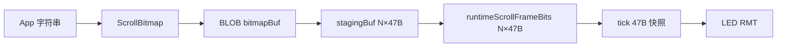
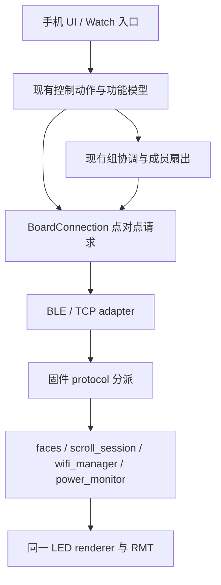

# 实际功能、接口与唯一实现：固件 × iOS 联合审计

> 最新复审：[当前未提交板端表情改动的联合复审](FUNCTION_INTERFACE_JOINT_REAUDIT_2026_10_15_ZH.md)。本文保留上一轮基线，不能用来代表当前表情保存流程。

日期：2026-10-15（America/Toronto）。基线：`316bb6da36f1c69ca5e55dd8b9ad412a9b229000` 与当前工作区。方法：Matt Pocock `codebase-design` / `improve-codebase-architecture`，以实际调用链、模块删除测试、数据所有权和接口不变量判断。此次产物是审计文档，没有实施源码重构。

## 1. 结论与审计口径

**主要问题已经从“同一功能多套底层实现”收敛为“兼容路径仍存、部分业务规则在多个入口重复、固件仍预展开整段滚动”。不应再加一层总管理器。**

“一个功能一个实现”指同一业务规则有一个拥有者，不指按钮、蓝牙、TCP、实体按键只能有一个入口；也不意味着本机收藏与板端收藏、实时视频与板内滚动应混为一体。必要的 adapter 只翻译输入输出，业务实现归位。小函数、有类型的命令包装本身不能作为臭抽象证据。

本报告覆盖当前固件、iPhone/iPad/Mac Catalyst 主应用、Watch 转发交互、协议和数据流；包括本地功能入口清单。`legacy/webui_v1` 是历史实现，不能把它的旧 HTTP 控制接口列为当前固件能力。当前 `web_setup.cpp` 只提供配网门户。未逐像素评审全部平台布局，未测量真机功耗、帧率或网络时延。

静态核对：**44 个 CMD 名称、13 个请求 opcode、6 个事件**两端集合一致；这只能证明声明覆盖，字段与行为仍需逐路径核对。完整清单见附录。

## 2. 实际功能 → 接口 → 实现总表

下表的“归属”是当前代码事实；“收敛”列是建议，尚未实现。路径均相对仓库根目录。

| 功能 | App 入口 / 接口 | 两端当前实现与数据方向 | 收敛判断 |
|---|---|---|---|
| BLE 发现、连接、通知 | ConnectionViewModel → BLETransport → BoardConnection.connect | CoreBluetooth；固件 transport_ble → protocol；握手 PING / subscribe / GET_* / get_info | 保留 BLE adapter；发现与请求生命周期不是同一功能 |
| Bonjour / 手动 LAN | connectBonjour / connectManualHost → TCPTransport | BonjourBrowser 解析 endpoint，TCP 同样进入 protocol | 共享同一握手、物理身份、session 合并；已接通 |
| 直连热点、网络切换、恢复 | HotspotJoiner、MacWiFiAdapter、BoardSessionStore、BoardConnection | 平台入网后 TCP；BoardConnection 负责单连接恢复，session 提供同板地址 | 平台差异保留；组成员拨号不得另写单连接重试规则 |
| 设备记忆、改名、组成员身份 | BoardStore / BoardSessionStore / setDeviceName | KnownBoard 本地持久化；board_identity / handleGetInfo / set_device_name | 地址是 endpoint，物理 boardId 才是同板身份 |
| 亮度、主颜色、预设 | BoardControlCenterModel.setBrightness / setColor → CMD | protocol → led_renderer.setBrightness / setColor；预设只在 App 查表 | Watch 与手机规则应汇入现有控制动作实现 |
| 自动/手动、轮播间隔、前后表情 | toggleAutoMode / step / setAutoInterval | set_mode / set_auto_interval / button B1/B2 → faces / runButtonAction | 保留实体按键入口；共享动作，不复制轮播算法 |
| 手绘、镜像、部件、撤销、草稿、帧导入 | ControlViewModel、PartsLibrary、PackedFrame | 本地编辑 → send / sendLive → SET_FRAME → handleSetFrame → applyPackedFrameQueued | 画布与部件共用最终 PackedFrame；无需两种发送实现 |
| Pencil 悬停 | pencilHover → set_hint_led | led_renderer.setHintLed；断连按 client owner 清理 | 与提交画面语义不同，保留独立命令 |
| 本机表情收藏 | FaceLibraryModel → LocalFaceStore | App JSON 文件；应用时走 SET_FRAME | 本机与板端存储目的不同，不能仅因同是收藏就强并存储 |
| 板端表情读/应用 | getFaces / applySavedFace | GET_FACES 分页+generation；apply_saved_face → faces.applySavedFaceIndex | 正常应用回包已有 frameHex；继续清理兼容回读 |
| 板端表情增删改排、清用户项 | faceUpsert / Rename / Delete / Reorder / ClearUser | sendFaceOp → 五个 handler → mutateFacesDocument → storage | 已共享事务内核；包装具备类型语义，不要求机械删除 |
| 整库导入导出 | FaceDocument、FaceLibraryModel；saveFaces → BLOB faces | 导出为文件；导入整库验证、原子替换、安装 runtime faces | 与单项 mutation 共用验证/提交；不能替换为非原子的 clear+多次 upsert |
| 单板滚动文字 | TextViewModel.send → ScrollRasterizer.makeTimeline → startScrollBitmapUpload | App 字体栅格化；bitmap BLOB；固件展开后 scroll_session 独立播放 | 主链只需 bitmap；raw 回退是待清理的第二格式 |
| 文字播放/暂停/继续/停止/定位/步进/循环/速度 | TextViewModel → scroll_* / set_scroll_* | scroll_session 拥有游标、用户/系统暂停、循环与时钟 | 保留一个播放状态机；通用 pause/resume 不能假定等价 |
| 文字预览与重连恢复 | ScrollTimeline.frame(at:) / ScrollPreviewController / restoreOnConnect | GET_SCROLL_META + sourceText 重建 + 新 GET_PREVIEW_SYNC；预览以呈现遥测校时 | 手机已按需采样；超长 BEGIN 丢文本的恢复缺口见 A1 |
| 多板文字、拼接/镜像、成员排序、编号 | BoardGroupCoordinator / GroupScrollBitmap / Group editor | 按 viewport 上传；clock_sample、group_start；identify 为独立 overlay | 组排程是真实额外职责；抽回共同的上传元数据构造即可 |
| 组亮度/颜色/表情/实时帧 | GroupControlFanOut / GroupAutoCycler | 主板命令钩子、成员队列与 lease；表情解析为主板实际位图后 SET_FRAME | 已有 outboundHook；不要继续声称连接层直接依赖具体组类型 |
| 麦克风口型、校准、映射、灵敏度 | LipSyncAudioCapture → LipSyncProcessor / LipSyncDSPEngine → LipSyncModel | 声音在 App 分析，LatestValueSender → setFrame；固件不运行 DSP | DSP 与发送职责分开合理；不把音频缓存当无效冗余 |
| 本地音频 + .rinalive 演出 | PresetLiveModel、LivePerformanceScript | 按音频时钟选帧 → LatestValueSender → SET_FRAME | 与视频/口型共享已有发送器，素材与时钟分别保留 |
| 视频文件/相册、量化、播放定位 | VideoPlayerModel → VideoFrameQuantizer | AVFoundation 解码 → LatestFrameProcessor → LatestValueSender → SET_FRAME | 解码计算是独有实现；不用再建 FrameStreamer 总框架 |
| Watch 控制、目标选择、状态 | WatchLinkSessionRelay / WatchLinkService.handle | Watch → iPhone → 既有连接；快照经 reply / applicationContext / live message | 手机直控规则有重复；三种投递的到达语义不同 |
| 电量/充电、校准、板端电量覆盖 | BoardBattery、DebugViewModel → GET_POWER / reset / overlay | power_monitor / battery_calibration / button_animations；EV_POWER 与 status.power | 电量单独频率有用途，先明确唯一缓存拥有者 |
| 调试、日志、原始命令、测试图案 | DebugViewModel、BoardConnection+Debug | GET_*、log_subscribe / subscribe.log、任意 CMD、SET_FRAME；串口诊断 | 调试读取接口不等于第二个业务实现 |
| 配网、扫描、AP/STA、凭据与模式 | BoardNetworkSettings / ConnectionViewModel → wifi_* | protocol.handleWifiCmd / HTTP → 同一个 wifiManager* 状态机 | 两种外部输入真实存在；共用业务验证，不必 HTTP 再编码 CMD JSON |
| 实体按键、启动、持久化、LED 输出 | 固件 main / buttons / storage / scroll / led_driver | Core 0 控制调度，Core 1 渲染；RMT 可选 DMA；LittleFS/NVS | 不应因为两个核心就删掉必要同步快照 |
| 启动动画、主题/语言、窗口布局、预览缩放 | Boot、Settings、Shared、LEDBoardPreview | App 本地；无额外固件接口 | 同一个控制动作可以嵌入不同容器；无需多套业务规则 |

关键证据：`BoardConnection.swift:1020`（transact）、`:1054`（command）、`:1350`（uploadBlob）、`:1485`（scrollBeginMeta）；`protocol.cpp:1072`（CMD）、`:1570`（SET_FRAME）、`:2250`（dispatch）；各附录行定位完整命令。

## 3. 必须更新的旧结论

以下结论不能从同日旧报告直接搬过来。

| 旧说法 | 当前代码复核 |
|---|---|
| 首次 LAN 保存漏物理身份、LAN 不合并 session（J1/J2） | 已修复。ConnectionViewModel:376、406 写 physicalBoardID；:378、407 调 consolidation；AddBoardView:199、218 传 sessions |
| 4096B 文本导致 BEGIN 必然被本地拒绝（J3） | 行为已变：scrollBeginMeta:1485 量完整 JSON，超限省略 sourceText；上传能继续，但恢复语义有缺口（A1） |
| App 正常 bitmap 上传也保留 N 个 PackedFrame | 已修复。ScrollTimeline:36–59 按 frame(at:) 采样；只有 raw 回退调用 materializedFrames |
| 每次 CMD 回显完整状态、SET_FRAME 回显大对象 | 已修复。protocol.reply:530 只带 ok 与表情定位；handleSetFrame:1605 只 ack；不再有旧报告所述 2KB 状态回显路径 |
| 表情增量写完再读文件解析第二次 | 已修复。mutateFacesDocument:718 调 installSavedFacesDocument(doc)，仍有整文档读取/校验/写盘，但不再写后回读 |
| RuntimeStore 成员访问器与自由函数并存；多套 LED 后端 | 已修复。state.cpp 自由访问函数；led_driver.cpp 当前只编译 RMT、DMA 是该驱动配置 |
| 直接加 command gateway / GroupRuntime / FrameStreamer 能解决问题 | 不成立。当前 transact、outboundHook、LatestValueSender 已承担共用职责；先删第二路径和重复规则 |

旧文档仍可作历史证据；本报告不覆盖其历史文本，以免抹去当时基线。

## 4. 当前仍成立的联合问题

### A1 · 上传成功却丢失文字恢复信息（P2，Strong）

`BoardConnection.scrollBeginMeta:1485–1500` 在完整 BEGIN 超过 4096B 时直接返回不含 sourceText 的 metadata。三个滚动上传入口均使用它。固件允许无文本播放，但 `TextViewModel.restoreOnConnect:708` 明确要求非空 sourceText；新会话因此不能靠板端重建文字、预览时间线和这些控制绑定。组恢复 `BoardGroupCoordinator.adoptRunningScroll:479–493` 同样要求成员原文非空且一致，因此也受影响。现有 `ios/RinaBoardTests/BlobBeginSourceTextBudgetTests.swift:11–64` 覆盖三入口的省字段行为，但不覆盖新会话恢复。

这是两端接口契约缺口，不是上传失败。当前已绑定的时间线不受影响；不能说每次重连都丢状态，但 App 冷启动或换手机可触发“板仍滚动、App 无法恢复”。可用一个可见 A + 1365 个 U+200D 构造 4096 UTF-8 字节，字体栅格化过滤格式字符后时间线仍很短，避免混淆帧数上限。

**最小收敛：**如果恢复是必备能力，上传前用完整 BEGIN 预算明确拒绝超限并反馈可发送上限，删除静默省字段行为；不新增另一种文字协议。若产品必须支持任意 4096B 原文，再单独改两端文本存放位置。没有必要同时保留“静默省略、raw 回退、之后猜测恢复”三种办法。

接口回归应验证：边界文本被明确拒绝，或成功后 GET_SCROLL_META 可恢复原文；不能只测试 BEGIN 可编码。

### A2 · bitmap 在固件仍整段展开，再复制入运行缓冲（成本优先，Worth exploring）

当前链：

证据：protocol.cpp:2076–2113 分配 staging、遍历展开、publish、释放；scroll_session.cpp:544–560 在锁内 memcpy 到 live；state.cpp:6 为 MAX_SCROLL_FRAMES×FRAME_BYTES 分配运行空间。

N=3072 时，单个展开缓冲为 **144384B（141KiB）**；发布期间 live 与 staging 合计 **288768B（282KiB）**，另加 bitmap 与控制数据。这是计算出的 payload 内存，不含 allocator 开销，也不代表实测峰值。预展开在 Core 0 dispatch 中执行，可能延迟其他控制请求；当前没有实测延迟数字。

**最小方向：**由既有 scroll_session 拥有一份已提交 bitmap 与采样参数，tick/seek 直接提取当前窗口，复用当前游标和组时钟；上传完整验证后交换所有权。不要在 live bitmap 上边写边播。这样才同时删除 staging、live 全帧缓存和 raw 格式。需要保持 rotation、viewportX、循环、暂停、seek 与 presented 时刻契约。

反例：每 tick 的 nextFrame → runtime frame → renderer localFrame 三次 47B 拷贝即使按 60fps 估计也仅 8460B/s；这是并发快照，不应先为省这几字节破坏锁与呈现一致性。值得优化的是整段展开与锁内大复制。

### A3 · raw 回退只接住一种错误，却维持完整第二格式（P3 / 维护成本，Strong）

TextViewModel:466–495 只捕获 timelineMismatch 后 materializedFrames → startScrollUpload；遇到“不支持 bitmap”的普通协议错误并不进入此分支。因此注释所称“兼容旧固件”不能代表覆盖全部旧固件。

当前服务端为 raw 和 bitmap 分别准备 BEGIN/CHUNK/END、offset 对齐、占用、接管处理；App 也各维护 metadata 和 reply 校验。**建议确定受支持固件范围后只保留 bitmap**，不增加错误重试路由。完成 A2 前不能假装删一个 catch 就删完所有底层格式。测试工具/硬件脚本也可能使用 raw，删除前应一起更新，不把“主 UI 没调用”当没有消费者。

### A4 · 表情正常回包已有帧，兼容读取仍残留（P3，Strong）

protocol.cpp:739 返回选定 face 的 frameHex，apply_saved_face 在:1431 使用；GroupControlFanOut:608 优先解析它，但仍保留 resolver 和:652 的“两次等待150ms + GET_FRAME”。B1/B2 使用通用 reply:530，仅携带 id/index，因此不能直接把整个回读路径删掉。

**最小收敛：**先让 B1/B2 的成功回包也返回同一份“已选表情帧”结果，再把组同步限定为消费该结果。不同板的收藏不一致，不能向成员重放相同 index。也不能仅因 App 有表情缓存就相信缓存总是最新。是否删除旧固件兼容由支持范围决定，不增加新的 resolver 层。

### A5 · 控制规则在 Watch 非当前板分支重写（P3，Strong）

WatchLinkService:349–386 一边调用 BoardControlCenterModel，一边 direct 分支重新 clamp、调用 command；:493 明注 mirror 主控制逻辑。模式/表情/间隔的规则随目标变化，未来修复容易只改单边。

**最小收敛：**把与 UI draft 无关的现有动作实现供所有目标调用，主控制模型继续拥有当前 UI 的 draft；Watch 只解析目标和参数。不新增一套 command dispatcher。reply 与 publish 还会分别 snapshot/encode（:84–95、562–576），可复用一次不可变快照。applicationContext 与即时回复分别服务后台最近状态和请求结果，不因“同样 JSON”就全部删除。

### A6 · 状态有多路投递，真正的问题是字段所有权（P3，Worth exploring）

protocol.cpp:421 把 power 放入状态；:2500 后 preview 按 BLE 250ms/TCP 100ms、status 按版本且至少200ms、power 每1s/充电变化发送。App 同时持有 status/preview/power/wifi/currentFrame。重叠成立，频率和新鲜度语义也确有不同。

**最小收敛：**明确 power 的唯一写入与读取位置，让 status 携带的初始 power 和 EV_POWER 更新同一快照；预览进度继续按 presented 时刻更新。先减少重复字段/解析和每客户端重复构建，再决定是否合并事件。不要把所有数据塞入一个高频 BoardState 大包，也不要盲删 GET_*：初次快照、调试和事件中断后同步有实际用途。

### A7 · 五个表情操作共享内核，但每次都读改写整文档（P3，Worth exploring）

protocol.cpp:674 的 mutateFacesDocument 读取、解析整库、修改、全库校验、原子写入，随后直接安装已解析文档；storage.cpp:246 校验还逐对比较 id，最多为 O(F²)。这是真成本，但当前没有 rename 延迟或 flash 寿命实测。

保留共用事务，不加 Repository/Store 两层。若实测频繁编辑受影响，可让现有 storage 持有规范文档，原子提交成功后更新 runtime；RuntimeFace[] 不一定能无损保存 JSON 中所有 metadata，不能未经字段核对就把它宣布为唯一持久化真相。整库导入与单条编辑具有不同原子性，不改为 clear + N 次 upsert。

### A8 · 生产与参考 DSP 两套公开算法入口（维护成本，Worth exploring）

RinaCore/LipSync.swift:239 与:266 保留两套 analyze，:294 与:301 保留两套 measure；生产口型从 LipSyncProcessor:32 使用缓存引擎，参考路径主要用于测试，但 LipSyncProfile.synthesized:178 仍使用参考 MFCC。存在算法漂移和维护成本，未证明当前热路径变慢。

生产计算统一复用已有 LipSyncDSPEngine；独立参考计算若要保留作差分 oracle，移入测试辅助实现，并保持独立性。不要把 engine 共用的 FFT/Mel 底层函数一起删掉。这里无需再建 DSP protocol / factory。

另有低优先级重复工作：RinaBoardApp:21 默认初始化 BoardStore，:62 又初始化覆盖；DebugViewModel:659–661 对同一 raw JSON 分别 flatten、pretty、typed decode。前者可单次初始化，后者可共用 JSONSerialization 结果；均未量化收益，不列为主要性能瓶颈。

## 5. 设计边界：保留与删减

| 判定 | 实际理由 |
|---|---|
| 保留 RinaTransport / 固件 carrier adapter | BLE 与 TCP 是两个生产实现，MTU、背压、生命周期真实不同 |
| 保留 request broker、连接代次、输出 lease | 分别保护请求关联、旧连接操作、同连接上被替换的内容生产者；三个 UUID 并非同一不变量 |
| 保留 blob owner、offset、事务提交、断连释放 | 防止多客户端和旧上传覆盖正在播放的新内容；这是实现正确性，不能以“不要兜底”删除 |
| 保留按帧采样、最新值发送、视频后台处理 | 当前已复用 LatestValueSender/LatestFrameProcessor；不需要第四个万能播放器 |
| 保留 MacWiFiBridgeProtocol | Catalyst 与 CoreWLAN 的平台接缝确实存在 |
| 不强行串口/HTTP → JSON → CMD | 当前两者已调用同一 wifiManager/动作；绕一遍 JSON 增加编码解析，没有自动消除业务重复 |
| 不因一行就删 faceRename 等 | 命令类型与表情 generation 事务语义有价值；删除后把 cmd 名和回复细节散给 UI，locality 反而下降 |
| 不自动移除 RinaFaceSync 包 | 主应用未链接/导入，不属于当前功能链；可归档候选，先核实独立使用者，不能宣称删除即可提升运行性能 |
| 不新增 style 参数统一所有 UI | 同一动作由不同容器呈现并非重复业务；颜色、电池等共用内容，紧凑/宽屏布局保留真实空间差异 |

“不要兜底”应落在明确受支持的协议与硬件范围上：删除不再支持的兼容分支；边界校验、事务回滚、断连释放与同步快照仍是实现本身。

## 6. 最小目标结构与处理顺序

以上是归属方向，不是建议新增八个类。当前 outboundHook 仍是扇出接线点，若后续改为功能入口显式选目标，应替换旧接线，不能新旧并留。

1. **先修 A1 的明确契约缺口**：完整 BEGIN 可发送预算与恢复要求一致；新增一项走真实上传→新会话恢复路径的回归。
2. **再收敛 A4/A5**：所有选表情动作回传同一结果；Watch 调用同一动作实现，删已失去消费者的兼容分支。
3. **明确支持范围后删 A3**：只留 bitmap；同时更新固件、App、调试目录与 host/hardware 工具。
4. **需要内存/控制响应收益时实施 A2**：既有 scroll_session 改为持有 bitmap，保留事务发布；用双板 tick/seek/重连/接管验证。
5. **最后依据测量做 A6/A7**：记录单命令 RTT、BLOB_END 占用控制循环时间、内存峰值、事件字节数；没有数据不报提速百分比。

不按“多删几千行”评价成功。验收是每项业务只有一个规则拥有者、无多余格式转换、结果明确、既有硬件行为保持。

## 7. 验证与限制

- 静态提取与集合断言通过：44 CMD、13 请求、6 事件，加 ERR=0xFF；全部命令源码链接的目标与行号范围检查通过。
- `python3 tools/protocol_selftest.py` 通过：5 个 C++ host test 文件、18 个 Python host test 文件。包含 staged publish、blob owner、帧接管、表情身份、RMT 故障注入等；其中有源码形状检查，不能全部等同于真实硬件执行。
- `swift test --disable-sandbox --package-path ios/Packages/RinaCore --scratch-path /tmp/rina-joint-audit-20261015/swift-build` 通过：**378 项，11 项跳过，0 失败**。为适配工作区权限，CLANG_MODULE_CACHE_PATH / SWIFTPM_MODULECACHE_OVERRIDE 均指向 `/tmp/rina-joint-audit-20261015/`；首次因默认缓存路径不可写失败，迁移缓存后完整重跑通过。
- `git diff --check` 通过。只新增本报告与 README 导航链接；已有 `BootAnimationRotationUITests.swift` 修改和 `.claude/merge-backup/` 未改动。
- iOS 独立只读审计由 GPT-6.1 Sol high 完成，关键判断已在主审计中复核。Grok 4.7 xhigh 固件取证因轮次上限未提交结论，未把它当已完成的独立审计；固件结论由当前源码与上述 host suite 核实。
- 未运行 RinaBoard 应用 target 测试、UI 测试、固件 PlatformIO 全量构建或刷机。`BlobBeginSourceTextBudgetTests` 属于应用 target，本次只阅读其源码，不能把 RinaCore 的通过结果当作该测试已运行。A1 的跨会话缺口是两端 guard 与省字段分支的静态证明，尚无端到端真机复现。
- 主机检查不能证明 BLE 无线、RMT/DMA、真机麦克风、双板时钟性能；不提供提速百分比或实测内存峰值。可视化候选快照位于临时文件 `architecture-review-20261015-1229.html`，Markdown 本报告是持久化总表。

## 附录 A · 全部请求与事件

| opcode | 固件名称 | iOS 类型 | 分派/实现 |
|---|---|---|---|
| `0x01` | `CMD` | `.cmd` | `handleCmd` |
| `0x02` | `GET_STATUS` | `.getStatus` | `handleGetStatus` |
| `0x03` | `GET_POWER` | `.getPower` | `handleGetPower` |
| `0x04` | `GET_SCROLL_META` | `.getScrollMeta` | `handleGetScrollMeta` |
| `0x05` | `GET_PREVIEW_SYNC` | `.getPreviewSync` | `handleGetPreviewSync` |
| `0x06` | `PING` | `.ping` | `handlePing` |
| `0x10` | `SET_FRAME` | `.setFrame` | `handleSetFrame` |
| `0x11` | `GET_FRAME` | `.getFrame` | `handleGetFrame` |
| `0x20` | `BLOB_BEGIN` | `.blobBegin` | `handleBlobBegin` |
| `0x21` | `BLOB_CHUNK` | `.blobChunk` | `handleBlobChunk` |
| `0x22` | `BLOB_END` | `.blobEnd` | `handleBlobEnd` |
| `0x23` | `BLOB_ABORT` | `.blobAbort` | `handleBlobAbort` |
| `0x24` | `GET_FACES` | `.getFaces` | `handleGetFaces` |
| `0xFF` | `ERR` | `.error` | `sendErrorReply（协议错误）` |
| `0x90` | `EV_PREVIEW_SYNC` | `.evPreviewSync` | `serviceProtocolEvents（订阅推送）` |
| `0x91` | `EV_STATUS` | `.evStatus` | `serviceProtocolEvents（订阅推送）` |
| `0x92` | `EV_POWER` | `.evPower` | `serviceProtocolEvents（订阅推送）` |
| `0x93` | `EV_WIFI` | `.evWifi` | `serviceProtocolEvents（订阅推送）` |
| `0x94` | `EV_LOG` | `.evLog` | `serviceProtocolEvents（订阅推送）` |
| `0x95` | `EV_WIFI_SCAN` | `.evWifiScan` | `serviceProtocolEvents（订阅推送）` |

事件 seq=0；请求由 RinaRequestBroker 关联，回复 type=request|0x80；GET_FACES 的 MORE 为客户端分页，不是同 seq 自动聚合。帧头6B，payload≤4096B；M370帧47B、尾字节高6位必须为0。

## 附录 B · 44 个 CMD 与当前固件实现

每行是现存 wire interface，不等于一个独立业务实现。相关参数编码统一见 `RinaCommand.jsonObject`；有类型的 case 是参数来源，固件 `handleCmd` / `handleWifiCmd` 是输入分派。下面按源码自动提取，覆盖集合已断言相等。

| CMD | iOS case | 固件分支位置 | 所属业务实现 |
|---|---|---|---|
| `set_color` | `.setColor` | [protocol.cpp:1296](../esp32s3_firmware/src/protocol.cpp#L1296) | led_renderer |
| `set_brightness` | `.setBrightness` | [protocol.cpp:1298](../esp32s3_firmware/src/protocol.cpp#L1298) | led_renderer |
| `set_hint_led` | `.setHintLED` | [protocol.cpp:1256](../esp32s3_firmware/src/protocol.cpp#L1256) | led_renderer |
| `set_mode` | `.setMode` | [protocol.cpp:1300](../esp32s3_firmware/src/protocol.cpp#L1300) | faces |
| `set_auto_interval` | `.setAutoInterval` | [protocol.cpp:1305](../esp32s3_firmware/src/protocol.cpp#L1305) | faces |
| `set_scroll_interval` | `.setScrollInterval` | [protocol.cpp:1307](../esp32s3_firmware/src/protocol.cpp#L1307) | scroll_session / faces.start/stopFirmwareScroll |
| `start_scroll` | `.startScroll` | [protocol.cpp:1310](../esp32s3_firmware/src/protocol.cpp#L1310) | scroll_session / faces.start/stopFirmwareScroll |
| `scroll_step` | `.scrollStep` | [protocol.cpp:1327](../esp32s3_firmware/src/protocol.cpp#L1327) | scroll_session / faces.start/stopFirmwareScroll |
| `scroll_seek` | `.scrollSeek` | [protocol.cpp:1335](../esp32s3_firmware/src/protocol.cpp#L1335) | scroll_session / faces.start/stopFirmwareScroll |
| `set_scroll_loop` | `.setScrollLoop` | [protocol.cpp:1325](../esp32s3_firmware/src/protocol.cpp#L1325) | scroll_session / faces.start/stopFirmwareScroll |
| `pause_scroll` | `.pauseScroll` | [protocol.cpp:1337](../esp32s3_firmware/src/protocol.cpp#L1337) | scroll_session / faces.start/stopFirmwareScroll |
| `resume_scroll` | `.resumeScroll` | [protocol.cpp:1339](../esp32s3_firmware/src/protocol.cpp#L1339) | scroll_session / faces.start/stopFirmwareScroll |
| `stop_scroll` | `.stopScroll` | [protocol.cpp:1342](../esp32s3_firmware/src/protocol.cpp#L1342) | scroll_session / faces.start/stopFirmwareScroll |
| `pause` | `.pause` | [protocol.cpp:1344](../esp32s3_firmware/src/protocol.cpp#L1344) | runtimeState + scroll_session（两命令行为不对称） |
| `resume` | `.resume` | [protocol.cpp:1348](../esp32s3_firmware/src/protocol.cpp#L1348) | runtimeState + scroll_session（两命令行为不对称） |
| `apply_saved_face` | `.applySavedFace` | [protocol.cpp:1354](../esp32s3_firmware/src/protocol.cpp#L1354) | faces |
| `button` | `.button` | [protocol.cpp:1399](../esp32s3_firmware/src/protocol.cpp#L1399) | buttons.runButtonAction → faces / renderer / power |
| `terminate_other_activities` | `.terminateOtherActivities` | [protocol.cpp:1410](../esp32s3_firmware/src/protocol.cpp#L1410) | faces.stopFirmwareScroll / setMode |
| `reset_battery_min` | `.resetBatteryMin` | [protocol.cpp:1413](../esp32s3_firmware/src/protocol.cpp#L1413) | power_monitor / button_animations |
| `reset_battery_max` | `.resetBatteryMax` | [protocol.cpp:1415](../esp32s3_firmware/src/protocol.cpp#L1415) | power_monitor / button_animations |
| `battery_overlay` | `.batteryOverlay` | [protocol.cpp:1417](../esp32s3_firmware/src/protocol.cpp#L1417) | power_monitor / button_animations |
| `reboot` | `.reboot` | [protocol.cpp:1181](../esp32s3_firmware/src/protocol.cpp#L1181) | esp_restart |
| `get_info` | `.getInfo` | [protocol.cpp:1099](../esp32s3_firmware/src/protocol.cpp#L1099) | board_identity / runtime settings |
| `subscribe` | `.subscribe` | [protocol.cpp:1189](../esp32s3_firmware/src/protocol.cpp#L1189) | ClientSlot 订阅标志 |
| `log_subscribe` | `.logSubscribe` | [protocol.cpp:1189](../esp32s3_firmware/src/protocol.cpp#L1189) | ClientSlot 订阅标志 |
| `wifi_status` | `.wifiStatus` | [protocol.cpp:541](../esp32s3_firmware/src/protocol.cpp#L541) | wifi_manager（handleWifiCmd） |
| `wifi_scan` | `.wifiScan` | [protocol.cpp:545](../esp32s3_firmware/src/protocol.cpp#L545) | wifi_manager（handleWifiCmd） |
| `wifi_scan_result` | `.wifiScanResult` | [protocol.cpp:562](../esp32s3_firmware/src/protocol.cpp#L562) | wifi_manager（handleWifiCmd） |
| `wifi_set_credentials` | `.wifiSetCredentials` | [protocol.cpp:569](../esp32s3_firmware/src/protocol.cpp#L569) | wifi_manager（handleWifiCmd） |
| `wifi_clear_credentials` | `.wifiClearCredentials` | [protocol.cpp:576](../esp32s3_firmware/src/protocol.cpp#L576) | wifi_manager（handleWifiCmd） |
| `wifi_set_mode` | `.wifiSetMode` | [protocol.cpp:593](../esp32s3_firmware/src/protocol.cpp#L593) | wifi_manager（handleWifiCmd） |
| `wifi_connect` | `.wifiConnect` | [protocol.cpp:600](../esp32s3_firmware/src/protocol.cpp#L600) | wifi_manager（handleWifiCmd） |
| `wifi_set_ap` | `.wifiSetAp` | [protocol.cpp:605](../esp32s3_firmware/src/protocol.cpp#L605) | wifi_manager（handleWifiCmd） |
| `wifi_set_hotspot_credentials` | `.wifiSetHotspotCredentials` | [protocol.cpp:581](../esp32s3_firmware/src/protocol.cpp#L581) | wifi_manager（handleWifiCmd） |
| `wifi_clear_hotspot_credentials` | `.wifiClearHotspotCredentials` | [protocol.cpp:588](../esp32s3_firmware/src/protocol.cpp#L588) | wifi_manager（handleWifiCmd） |
| `face_rename` | `.faceRename` | [protocol.cpp:1207](../esp32s3_firmware/src/protocol.cpp#L1207) | mutateFacesDocument / storage |
| `face_reorder` | `.faceReorder` | [protocol.cpp:1211](../esp32s3_firmware/src/protocol.cpp#L1211) | mutateFacesDocument / storage |
| `face_delete` | `.faceDelete` | [protocol.cpp:1215](../esp32s3_firmware/src/protocol.cpp#L1215) | mutateFacesDocument / storage |
| `face_upsert` | `.faceUpsert` | [protocol.cpp:1219](../esp32s3_firmware/src/protocol.cpp#L1219) | mutateFacesDocument / storage |
| `faces_clear_user` | `.facesClearUser` | [protocol.cpp:1223](../esp32s3_firmware/src/protocol.cpp#L1223) | mutateFacesDocument / storage |
| `set_device_name` | `.setDeviceName` | [protocol.cpp:1228](../esp32s3_firmware/src/protocol.cpp#L1228) | board_identity / runtime settings |
| `identify` | `.identify` | [protocol.cpp:1116](../esp32s3_firmware/src/protocol.cpp#L1116) | led_renderer |
| `clock_sample` | `.clockSample` | [protocol.cpp:1105](../esp32s3_firmware/src/protocol.cpp#L1105) | 单调时钟 / scroll_sessionGroupStart |
| `group_start` | `.groupStart` | [protocol.cpp:1135](../esp32s3_firmware/src/protocol.cpp#L1135) | 单调时钟 / scroll_sessionGroupStart |

### 需区分语义的现存命令

- `pause` 只写 runtimeState.paused/playback（protocol.cpp:1344），`pause_scroll` 改 scroll_session 用户暂停；不要以同名暂停视为可替换。当前正常文字 UI 使用后者，未据此断言暂停按钮已坏。
- `subscribe.log` 与 `log_subscribe` 操作同一订阅位，后者是兼容接口候选。
- `start_scroll`、BLOB_END.start、`group_start` 有不同启动上下文；组定时起播不等于另一套文字生成。只删除已无消费者的重复入口。
- `wifi_scan` 异步事件与 `wifi_scan_result` 查询共存；App 还接收同步结果。受支持范围统一后可收敛，但扫描正在进行与空结果不能混为一谈。
- `BLOB faces` 是整库原子替换；`face_upsert.expect` 与 GET_FACES generation 维护多客户端编辑一致性，不是无意义兜底。
