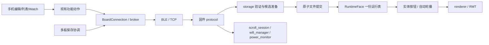

# 固件 × iOS 功能接口与架构重新审计

日期：2026-10-15，America/Toronto。基线：`c3a64ed` 加当前未提交工作区，包含板端表情、ID-only 部件、多板保存和条件读写的新实现。**不能仅以 HEAD 复现本报告**；取证开始/结束的360个源文件指纹一致，摘要及可复现探针见[证据目录](audits/2026-10-15-joint-reaudit/README.md)。

使用 Matt Pocock `codebase-design` / `improve-codebase-architecture`：按 interface 的实际规则、module 的归属、删除测试与数据所有权审查；不以类数、函数长度或一行包装判断抽象好坏。此次只生成审计与证据，不修产品代码，不提交、刷机或写实体板。

## 1. 重新审计结论

当前没有发现需要增加一层总管理器的理由。固件新的表情提交路径比上一轮更集中：**准备候选运行表 → 原子落盘 → 发布同一运行表 → ACK**；按钮和自动轮播仍使用同一 RuntimeFace 列表。最应先处理的是 App 保存生命周期与身份规则不一致。

| 编号 | 严重度 / 证据 | 当前问题 |
|---|---|---|
| R1 | P2 / 生产协调器隔离探针复现 | 多板保存遇到冲突或长期不可用目标后，没有明确结束操作的入口，继续拦住后续编辑保存 |
| R2 | P2 / 生产函数提取探针复现 | 单板保存仍把 wifi:host 当可跨连接代次的物理身份；多板保存已拒绝同类歧义 |
| R3 | P3 / 静态链路确认 | 列表复制在 pending 后重新生成副本名，用新名字匹配 pending，可能绕开原提交的核对并新建第二项 |
| R4 | P3 / 生产协议host探针复现 | App禁止默认表情改名，固件face_rename却接受并落盘，同一保护规则分在两端且不一致 |
| C1 | 架构成本 / 无性能实测 | 单板编辑、列表复制、多板保存分别维护三套 journal 与 reconcile 规则，已经造成退出与身份语义差异 |
| C2 | 架构成本 / 无性能实测 | 单条表情 mutation 仍重复全库验证/物化；JSON 编解码在 App 与固件内还可收敛 |

上轮 A1–A8 仍有对应实现，但 A7 的建议必须更新：现在固件已经把“候选运行表准备”放到落盘前，不能再建议补建这套实现。正式本机表情库也已经退出主 UI；上一轮“本机/板端两份正式收藏”的描述不再代表当前产品。

## 2. 功能与 interface 的当前唯一归属

| 实际功能 | App 入口与 wire interface | 当前实现拥有者 / 复核结论 |
|---|---|---|
| 发现、入网、连接、恢复 | ConnectionViewModel → BLETransport / TCPTransport → BoardConnection | 两种真实 adapter；Bonjour 与 HotspotJoiner 负责发现/入网，共享握手与请求实现 |
| 颜色、亮度、模式、间隔、换表情 | BoardControlCenterModel → CMD；Watch 转发 | 固件 led_renderer / faces / buttons；Watch 非当前目标仍复制动作规则（旧 A5） |
| 画布、部件、撤销、悬停、实时发送 | ControlViewModel → SET_FRAME / set_hint_led | 画面最终统一为 PackedFrame；悬停有独立 owner/清理语义 |
| 板上表情列表 | FaceLibraryView.location 固定 .board → FaceLibraryModel.reload → GET_FACES | 正式表情归板；连接代次校验后才显示；旧本机库只通过显式迁移进入 |
| 单板编辑保存 | ControlViewModel.saveEditedFace → FaceLibraryModel.save → face_upsert | 固定 ID、expect、boot/gen、读回核对；pending 保存在 face 草稿中 |
| 列表“创建副本”与旧库迁移 | FaceLibraryModel.copy / save | stable ID 与 pending 保存在 board_face_creates；与编辑/多板 journal 不共享操作生命周期 |
| 多板保存 | FrozenFaceSaveDestination → MultiBoardFaceSaveCoordinator | 每目标固定 ID/表示、物理身份、generation/carrier；仅重试未确认目标；不是跨板原子事务 |
| 固件表情物化与提交 | handleFaceUpsert / BLOB faces → storage.writeSavedFaces | canonicalize/materialize → PreparedSavedFaces → 文件 rename → publish；按钮/auto 复用 RuntimeFace |
| 纯部件存储 | App canonicalPayload → ID-only parts；固件 expression_parts | App 先确认部件合成等于实际像素；固件目录同源生成；落盘存编号，runtime 合成47B |
| 自定义存储 | face_upsert.frameHex / 整库 frameBytes | 最终47B点阵；颜色亮度仍为板级设置；不是 PNG 或另一条图像管线 |
| 表情导入/导出/排序/改名/删除 | BLOB faces / GET_FACES / face_* | whole replace 与单条编辑保留不同事务语义；不能换成 clear + N 次 upsert |
| 单板文字、预览、恢复 | ScrollRasterizer → bitmap BLOB → scroll_session | App 已按需采样；固件仍展开全帧；超限省 sourceText 的恢复缺口仍在 |
| 多板拼接/镜像文字 | BoardGroupCoordinator → viewport BLOB / clock_sample / group_start | 同一位图准备、成员时钟排程；组定时播放不是另一套文字生成 |
| 组通用控制与同步轮播 | GroupControlFanOut / GroupAutoCycler | 输出钩子、成员 lease、主板实际表情帧镜像；旧回读路径仍在 |
| 麦克风口型 | LipSyncAudioCapture / Processor / DSPEngine → SET_FRAME | App 分析音频，固件只显示帧；参考/缓存算法重复入口仍在 |
| 音频关键帧演出、视频 | PresetLiveModel / VideoPlayerModel → LatestValueSender → SET_FRAME | 共享发送；各自音频/视频时钟和量化保留；不需要新的万能播放器 |
| 状态、电量、日志、调试、配网 | GET_* / EV_* / CMD wifi_*；HTTP配网入口 | power_monitor、wifi_manager 等现有 module 拥有业务规则；状态投递重叠不等于每种读取都无用 |
| 本地 UI 与草稿 | Boot / Settings / Shared / DraftStorage | 无新增 wire 功能；未提交草稿不进入正式列表；多容器布局不复制业务动作 |

**整体数据流：**

多板保存协调当前仍借用 FaceLibraryModel 做每板 reload/save；这可以复用已有实现，但它同时拉入了 UI 库状态、旧本机库依赖和错误文案。后续收敛应在现有保存实现中处理共同不变量，不能再套一个 Repository → Service → Gateway。

## 3. R1：冲突后无法结束，多板操作持续锁住新保存

**触发：**A已保存；B的原表情被他端删除或修改，或者B永久不可用。重试后 B 进入 conflict/unavailable；用户想结束本次操作，再保存其他内容。

证据：

- [MultiBoardFaceSaveCoordinator.swift:222](../ios/RinaBoard/Features/Faces/MultiBoardFaceSaveCoordinator.swift#L222) 和 [:237](../ios/RinaBoard/Features/Faces/MultiBoardFaceSaveCoordinator.swift#L237) 会保留 conflict 并继续，不会结束操作。
- [:289](../ios/RinaBoard/Features/Faces/MultiBoardFaceSaveCoordinator.swift#L289) 的 finishIfConfirmed 只在 allConfirmed 时删除 journal。
- [MultiBoardFaceSaveViews.swift:137](../ios/RinaBoard/Features/Faces/MultiBoardFaceSaveViews.swift#L137) 只有重试；[:147](../ios/RinaBoard/Features/Faces/MultiBoardFaceSaveViews.swift#L147) 的“完成”调用 finishIfConfirmed 后直接 dismiss，不能结束冲突操作。
- [ControlView.swift:413](../ios/RinaBoard/Features/Control/ControlView.swift#L413) 遇到既有 operation 只回结果页；[ControlViewModel.swift:820](../ios/RinaBoard/Features/Control/ControlViewModel.swift#L820) 也拒绝 retained operation 下的新单板保存。

**探针结果：**调用原生产 prepare → retry，假库只负责返回“同ID已被修改”；实际协调器得到 conflict。再调用生产 finishIfConfirmed，journal 仍存在；新名字的 prepare 返回 false。[输出](audits/2026-10-15-joint-reaudit/probe-output.txt)。这是保存协调生命周期的复现，不是 UI 点击或实体板测试。

**最小改法方向：**同一协调器增加明确的“结束本次操作/放弃未完成目标”语义，保留已确认结果；对结果未知的目标明确说明可能已写入，而不悄悄回滚或重发。不可把“所有目标必须成功”当成“允许开始下一项工作”的永久条件。无需新建任务管理器。

**应补接口测试：**部分成功+冲突 → 明确结束 → 可开始无关新保存；确认目标不重发，未知目标不自动删除板端数据。

## 4. R2：单板把地址当身份，多板却已正确区分

[BoardConnection.swift:1202](../ios/RinaBoard/Services/BoardConnection.swift#L1202) 的 boardKey 在缺少物理身份时返回 `wifi:host`；[FaceLibraryModel.swift:1285](../ios/RinaBoard/Features/Faces/FaceLibraryModel.swift#L1285) 的 sameBoard 只要 key 非nil就按字符串相等，忽略连接 generation。[ControlViewModel.swift:839](../ios/RinaBoard/Features/Control/ControlViewModel.swift#L839) 对命名时目标的判断也采用类似规则。

**触发：**未知物理身份的A经某host编辑/保存 → 断开 → 同一host现在连接到未知身份B → 旧来源key相等。单板逻辑可能继承A的编辑ID或待确认目标。在旧固件不支持条件写时可向B更新同ID；即使有条件写，待确认新增在 ControlViewModel:914–922 会用当前连接的新 boot/gen 重绑重试，因此条件写也不替代同板身份验证。不是当前固件正常提供身份时必现，也不是正常 DHCP 地址变化必连错。

生产 sameBoard 提取探针使用不同UUID、同 `wifi:reused.local`，返回true。现有 [BoardFaceSaveIdentityTests.swift:7](../ios/RinaBoardTests/BoardFaceSaveIdentityTests.swift#L7) 甚至把 `wifi:rina.local` 跨generation继续更新作为成功预期。反观 [MultiBoardFaceSaveTests.swift:189](../ios/RinaBoardTests/MultiBoardFaceSaveTests.swift#L189) 已测试“同地址、无physicalID不可重绑”。这说明规则分叉，不是缺少第四套身份字段。

**最小改法方向：**重用既有 boardIdentity 判断是否具备物理身份；地址只用于拨号。在无物理身份时仅允许原 generation/carrier；跨连接重绑需要明确物理身份。不要从非nil的 boardKey 推断其为物理身份。统一单板与多板的判断，并同步更正旧测试预期。

## 5. R3：复制名称在恢复前变化，绕开原pending提交

[FaceLibraryModel.swift:836](../ios/RinaBoard/Features/Faces/FaceLibraryModel.swift#L836) 的 copy 每次用 copyName 构造新payload；[:1462](../ios/RinaBoard/Features/Faces/FaceLibraryModel.swift#L1462) 从当前库算“副本/副本2”；而 [:551](../ios/RinaBoard/Features/Faces/FaceLibraryModel.swift#L551) 的 pending 匹配键包含这个新名字。

**触发：**首次“创建副本”已在板上提交，但读回失败，返回pending；刷新后看到了该副本；对原表情再点相同动作希望重试。新动作先计算“副本2”，无法匹配旧pending，又分配新UUID。旧提交未通过原pending核对，第二次新增已经开始。

这是静态链路结论，本次未编译整个 FaceLibraryModel 复现，亦不能说每次主动“再复制一次”都是错误。缺口在于 pending 状态后没有清晰区分“核对上次”与“另建一项”，且实现注释承诺重复动作先核对旧提交。

**最小改法方向：**复制操作首次准备时冻结名字、来源、目标ID；先定位既有操作再生成新副本名。与单板/多板共用同一保存提交与核对规则；不要靠更多 payload 字段拼凑恢复匹配键。

## 5.1 R4：默认表情改名的保护规则在两端不一致

[FaceLibraryModel.swift:776](../ios/RinaBoard/Features/Faces/FaceLibraryModel.swift#L776) 对默认/锁定项直接拒绝rename；[protocol.cpp:830](../esp32s3_firmware/src/protocol.cpp#L830) 的handleFaceRename找到id后只写name，没有相同保护判断。默认项在face_delete/face_upsert中反而有专门检查。

在生产协议host harness中，对type=default的f0发送带正确boot/gen的face_rename：得到0x81成功回复、generation递增、RuntimeFace.name已改变，isDefault仍为true。[复现脚本](audits/2026-10-15-joint-reaudit/default-rename-probe.py)。这改变名字，不改变图像、ID或默认保护类型；不是普通App按钮已经能绕过自身guard。

最小方向是把默认表情允许修改哪些字段的规则明确归固件提交实现，App展示同样限制；若改名本应允许，就统一放开App，而不是两端保留互相矛盾的规则。无需新增保护策略层。整库导入替换默认项是另一种显式事务，不与单项改名混为一个缺陷。

## 6. 真正该合并的重复，与应保留的深度

### C1：三套保存恢复规则，而非三种用户流程

| 流程 | journal | 重复规则 |
|---|---|---|
| 编辑器单板 | ControlViewModel.PendingBoardSave → DraftStorage face | 固定UUID、来源/版本、pending、reload、内容/order核对、createOnly重试 |
| 列表复制 | FaceLibraryModel.PendingCreate → board_face_creates | 固定UUID、来源/版本、pending、reload、内容核对、createOnly重试 |
| 多板保存 | MultiBoardFaceSaveCoordinator.Operation → multi_board_face_save | 同一套规则再加每目标状态/部分成功 |

流程差异有意义，共同机制重复没有额外收益。R1/R2/R3 已显示规则在退出、身份、操作定位处不同。最小收敛是让现有保存实现拥有共同的“固定提交+核对”过程；多板只迭代目标和汇总结果，编辑草稿只引用其提交ID。替换旧分支而非新旧并存。不需要泛型工作流、回退策略列表或跨板分布式事务。

`DraftStorage` actor 只让单次 read/write 串行，不让多个 await 之间的读改写成为事务；各实例的 busy 也不能代表存储级互斥。但当前 Info.plist 的 UIApplicationSupportsMultipleScenes=false，**不能从 WindowGroup 就断言产品支持多窗口、并把双实例覆盖当已复现UI问题**。本轮不把该潜在竞争列成现存确定错误。

### C2：固件验证重复与 App JSON 往返

- protocol.mutateFacesDocument:720 先validate；writeSavedFaces:556 进入 canonicalizeSavedFaces，内部validate两遍，再 PreparedSavedFaces.prepare 再物化。不同阶段的事务保障有价值，但相同候选不必反复做全部materialize和 O(F²) ID检查。可由现有storage一次准备候选、规范化、预算、校验，然后提交；protocol只分派参数与返回结果。
- parts上传为了旧协议会“编号 → 临时47B → JSON frameBytes → canonicalize删frameBytes → runtime再合成47B”。这是真实表示转换，当前规模最多128项；未实测慢到影响产品，不应宣称已经性能低下。当前 materialize 已统一，不要另建 PartsRepository。
- BoardConnection.sendFaceOp:1729 把 RinaCommand.encode 的Data再JSONSerialization解回字典，插入expected版本后再编码。RinaCommand已提供jsonObject，可直接从同一结构加入metadata再编码一次。无需另造gateway。
- FaceLibraryModel.reload:371 先JSONSerialization验信封，再 decodedForImport解码；BoardConnection缓存原始Data、库模型缓存typed值是不同职责，但重复解析可在现有严格解码入口合并。不要让UI各自写一份宽松解码和兜底。
- App PartsLibrary 与固件生成头文件是两个执行平台的实际实现；generate_expression_parts --check 和逐组合对照保证同源，不是可以任意删掉一端的抽象。

保留：BLE/TCP adapter、请求broker、连接generation、输出lease、blob owner/原子发布、按呈现时刻同步、47B跨核快照、未知保存结果的明确核对。删除这些会把正确性规则散回调用者，不能通过模块删除测试。

## 7. 上轮八项逐项复核

| 上轮项 | 本轮状态 / 当前证据 |
|---|---|
| A1 原文省略破坏恢复 | 仍在。BoardConnection:1540–1555；TextViewModel:708、BoardGroupCoordinator:481要求非空sourceText。主机测试通过不能证明该恢复契约正确 |
| A2 固件整段展开 | 仍在。protocol:2119–2151 staging；scroll_session:544–560发布复制。3072×47=144384B；双展开payload合计282KiB，不是实测峰值 |
| A3 raw回退 | 仍在。TextViewModel:472–480；只catch timelineMismatch，不能当完整旧固件支持方案 |
| A4 表情回读 | 仍在。GroupControlFanOut:608/612/652，帧→缓存→两次150ms读回；普通B1/B2回复未变成带帧的唯一结果 |
| A5 Watch重复动作 | 仍在。WatchLinkService:493/499/506；目标不同导致两处模式/步进规则 |
| A6 状态多路 | 仍在。protocol:2610/2623，status含power且另发power；频率/新鲜度不同，不直接改成高频全状态大包 |
| A7 表情整库读改写 | 仍有成本，但事务改进已落地：storage:556–578在rename前prepare，随后publish；共享GET_FACES不可变snapshot也已落地 |
| A8 参考/缓存DSP入口 | 仍在。LipSync:239/266、294/301；生产缓存路径已使用，不称其为当前热路径重复执行 |

其它沿用结论：LAN身份保存/session合并、大CMD ACK、手机常驻全时间线、写后再读盘、RuntimeStore双接口、多LED后端都已在上一轮前修复。本次没有把这些作为新问题。

## 8. 验证与未覆盖范围

- 新运行 `python3 tools/protocol_selftest.py`：**通过**，5个C++与21个Python host test文件。包括新增部件生成/组合对照、saved-face事务与故障回滚、128项容量、条件写、不可变分页、BLOB提交冲突。
- 新运行 RinaCore `swift test`：**379项，11项跳过，0失败**。完整构建/缓存放在 `/tmp/rina-reaudit-20261015/`，不依赖之前378项的结果。
- R1/R2隔离生产源码探针：编译退出0、执行退出0，输出确认上述不期望行为。依赖是假连接/假库，真实协调器、sameBoard函数和DraftStorage；不连接无线或实体板。
- 360个源文件哈希起止未变。文档源码链接与命令集合另行静态检查；当前44 CMD / 13请求 / 6事件，新增能力体现为参数/条件语义与capabilities，没有新增opcode。
- 本次没有运行完整RinaBoard应用测试、UI测试、PlatformIO固件全构建或双板实测。其它会话文档所记796项、硬件128表情等只作为历史记录，不冒充本次验证；最终真机保存协调验收仍需可用硬件。
- Grok 4.7 xhigh 完成限定固件取证；GPT-6.1 Sol high 完成iOS只读取证。采纳并核对：重复物化/转换、默认改名规则差异、单板身份和多板生命周期。没有采纳“重启后gen归零就是事务错误”之类推论：真实boardBootId会随启动重新生成；boot/gen正是组合契约。
- R4新增主机探针通过执行确认了不一致：生产face_rename接受默认项改名；其它既有faces_transfer断言仍通过。该探针只改临时生成的host C++，没有改生产源或原测试。输出已归档至证据目录。

## 9. 修复顺序

1. R1：给现有多板操作明确结束语义，避免非成功目标永久锁住编辑保存。
2. R2：统一物理身份与地址的区别；无身份时不允许跨generation继承保存目标。
3. R4：明确默认项字段修改契约，让固件与App保持一致。
4. R3/C1：共用既有保存提交/核对机制，复制先定位旧操作，再生成新名字。
5. A1：完整BEGIN预算与“成功后能恢复”的契约一致，不静默降级成功语义。
6. 其余性能与维护成本按测量排序：先消除整段展开/重复全库转换，再考虑小对象解析。不要为减少几次47B拷贝破坏并发一致性。

上述均为审计建议，尚未实施。当前最小结构是“一个保存提交实现，多板遍历目标”；不是再叠加通用工作流、仓储、网关四层。

## 附录：当前 wire interface 全覆盖

全部 CMD 通过相同 `RinaCommand.jsonObject` 构造；新增表情版本条件由 BoardConnection.faceWriteMetadata 附加。下面从本轮当前源码提取并检查名称集合相等；同一业务的多个入口不等于多个业务实现。

| CMD | iOS case | 固件处理分支 |
|---|---|---|
| `set_color` | `.setColor` | [protocol.cpp:1329](../esp32s3_firmware/src/protocol.cpp#L1329) |
| `set_brightness` | `.setBrightness` | [protocol.cpp:1331](../esp32s3_firmware/src/protocol.cpp#L1331) |
| `set_hint_led` | `.setHintLED` | [protocol.cpp:1289](../esp32s3_firmware/src/protocol.cpp#L1289) |
| `set_mode` | `.setMode` | [protocol.cpp:1333](../esp32s3_firmware/src/protocol.cpp#L1333) |
| `set_auto_interval` | `.setAutoInterval` | [protocol.cpp:1338](../esp32s3_firmware/src/protocol.cpp#L1338) |
| `set_scroll_interval` | `.setScrollInterval` | [protocol.cpp:1340](../esp32s3_firmware/src/protocol.cpp#L1340) |
| `start_scroll` | `.startScroll` | [protocol.cpp:1343](../esp32s3_firmware/src/protocol.cpp#L1343) |
| `scroll_step` | `.scrollStep` | [protocol.cpp:1360](../esp32s3_firmware/src/protocol.cpp#L1360) |
| `scroll_seek` | `.scrollSeek` | [protocol.cpp:1368](../esp32s3_firmware/src/protocol.cpp#L1368) |
| `set_scroll_loop` | `.setScrollLoop` | [protocol.cpp:1358](../esp32s3_firmware/src/protocol.cpp#L1358) |
| `pause_scroll` | `.pauseScroll` | [protocol.cpp:1370](../esp32s3_firmware/src/protocol.cpp#L1370) |
| `resume_scroll` | `.resumeScroll` | [protocol.cpp:1372](../esp32s3_firmware/src/protocol.cpp#L1372) |
| `stop_scroll` | `.stopScroll` | [protocol.cpp:1375](../esp32s3_firmware/src/protocol.cpp#L1375) |
| `pause` | `.pause` | [protocol.cpp:1377](../esp32s3_firmware/src/protocol.cpp#L1377) |
| `resume` | `.resume` | [protocol.cpp:1381](../esp32s3_firmware/src/protocol.cpp#L1381) |
| `apply_saved_face` | `.applySavedFace` | [protocol.cpp:1387](../esp32s3_firmware/src/protocol.cpp#L1387) |
| `button` | `.button` | [protocol.cpp:1432](../esp32s3_firmware/src/protocol.cpp#L1432) |
| `terminate_other_activities` | `.terminateOtherActivities` | [protocol.cpp:1443](../esp32s3_firmware/src/protocol.cpp#L1443) |
| `reset_battery_min` | `.resetBatteryMin` | [protocol.cpp:1446](../esp32s3_firmware/src/protocol.cpp#L1446) |
| `reset_battery_max` | `.resetBatteryMax` | [protocol.cpp:1448](../esp32s3_firmware/src/protocol.cpp#L1448) |
| `battery_overlay` | `.batteryOverlay` | [protocol.cpp:1450](../esp32s3_firmware/src/protocol.cpp#L1450) |
| `reboot` | `.reboot` | [protocol.cpp:1209](../esp32s3_firmware/src/protocol.cpp#L1209) |
| `get_info` | `.getInfo` | [protocol.cpp:1127](../esp32s3_firmware/src/protocol.cpp#L1127) |
| `subscribe` | `.subscribe` | [protocol.cpp:1217](../esp32s3_firmware/src/protocol.cpp#L1217) |
| `log_subscribe` | `.logSubscribe` | [protocol.cpp:1217](../esp32s3_firmware/src/protocol.cpp#L1217) |
| `wifi_status` | `.wifiStatus` | [protocol.cpp:537](../esp32s3_firmware/src/protocol.cpp#L537) |
| `wifi_scan` | `.wifiScan` | [protocol.cpp:541](../esp32s3_firmware/src/protocol.cpp#L541) |
| `wifi_scan_result` | `.wifiScanResult` | [protocol.cpp:558](../esp32s3_firmware/src/protocol.cpp#L558) |
| `wifi_set_credentials` | `.wifiSetCredentials` | [protocol.cpp:565](../esp32s3_firmware/src/protocol.cpp#L565) |
| `wifi_clear_credentials` | `.wifiClearCredentials` | [protocol.cpp:572](../esp32s3_firmware/src/protocol.cpp#L572) |
| `wifi_set_mode` | `.wifiSetMode` | [protocol.cpp:589](../esp32s3_firmware/src/protocol.cpp#L589) |
| `wifi_connect` | `.wifiConnect` | [protocol.cpp:596](../esp32s3_firmware/src/protocol.cpp#L596) |
| `wifi_set_ap` | `.wifiSetAp` | [protocol.cpp:601](../esp32s3_firmware/src/protocol.cpp#L601) |
| `wifi_set_hotspot_credentials` | `.wifiSetHotspotCredentials` | [protocol.cpp:577](../esp32s3_firmware/src/protocol.cpp#L577) |
| `wifi_clear_hotspot_credentials` | `.wifiClearHotspotCredentials` | [protocol.cpp:584](../esp32s3_firmware/src/protocol.cpp#L584) |
| `face_rename` | `.faceRename` | [protocol.cpp:1235](../esp32s3_firmware/src/protocol.cpp#L1235) |
| `face_reorder` | `.faceReorder` | [protocol.cpp:1235](../esp32s3_firmware/src/protocol.cpp#L1235) |
| `face_delete` | `.faceDelete` | [protocol.cpp:1236](../esp32s3_firmware/src/protocol.cpp#L1236) |
| `face_upsert` | `.faceUpsert` | [protocol.cpp:1236](../esp32s3_firmware/src/protocol.cpp#L1236) |
| `faces_clear_user` | `.facesClearUser` | [protocol.cpp:1237](../esp32s3_firmware/src/protocol.cpp#L1237) |
| `set_device_name` | `.setDeviceName` | [protocol.cpp:1261](../esp32s3_firmware/src/protocol.cpp#L1261) |
| `identify` | `.identify` | [protocol.cpp:1144](../esp32s3_firmware/src/protocol.cpp#L1144) |
| `clock_sample` | `.clockSample` | [protocol.cpp:1133](../esp32s3_firmware/src/protocol.cpp#L1133) |
| `group_start` | `.groupStart` | [protocol.cpp:1163](../esp32s3_firmware/src/protocol.cpp#L1163) |

| opcode | 固件 / App 对应 |
|---|---|
| `0x01` | `CMD` / `.cmd` |
| `0x02` | `GET_STATUS` / `.getStatus` |
| `0x03` | `GET_POWER` / `.getPower` |
| `0x04` | `GET_SCROLL_META` / `.getScrollMeta` |
| `0x05` | `GET_PREVIEW_SYNC` / `.getPreviewSync` |
| `0x06` | `PING` / `.ping` |
| `0x10` | `SET_FRAME` / `.setFrame` |
| `0x11` | `GET_FRAME` / `.getFrame` |
| `0x20` | `BLOB_BEGIN` / `.blobBegin` |
| `0x21` | `BLOB_CHUNK` / `.blobChunk` |
| `0x22` | `BLOB_END` / `.blobEnd` |
| `0x23` | `BLOB_ABORT` / `.blobAbort` |
| `0x24` | `GET_FACES` / `.getFaces` |
| `0xFF` | `ERR` / `.error` |
| `0x90` | `EV_PREVIEW_SYNC` / `.evPreviewSync` |
| `0x91` | `EV_STATUS` / `.evStatus` |
| `0x92` | `EV_POWER` / `.evPower` |
| `0x93` | `EV_WIFI` / `.evWifi` |
| `0x94` | `EV_LOG` / `.evLog` |
| `0x95` | `EV_WIFI_SCAN` / `.evWifiScan` |

表情新增契约：

- `faces_parts_v4`：ID-only parts目录；partsCatalog / partsVersion / call必须对应同源目录。
- `faces_conditional_v1`：expectedBootId + expectedGen成对；createOnly在提交前拒绝已有ID。旧客户端省略版本仍按原协议无条件写，这是仍在支持的兼容路径。
- `faces_snapshot_v1`：GET_FACES共享单份不可变展开投影；generation变化后旧分页409。
- `faces_conditional_read_v1`：ifUnchanged + bootId + gen核对后可返回只有4B generation的回复；App只在持有同board/boot/gen缓存时复用。
- `BLOB faces`：BEGIN登记版本，END再次核对，避免上传期间别的客户端提交后被整库覆盖。

帧头6B、payload≤4096B；47B M370尾字节只允许低两位；请求回复type|0x80、事件seq=0；GET_FACES的MORE是下一页请求，不能按同seq盲目聚合。
