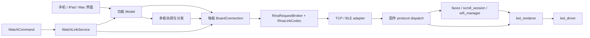

# 实际功能、接口与实现审查

审查日期：2026-10-15。基准提交：`e7588cd`，**包含审查时工作区未提交的修改及新文件**。这是当前源码的静态盘点，不是 README 的功能复述，也不是已经完成的重构。

采用 Matt Pocock `improve-codebase-architecture` 与 `codebase-design` 的方法：从调用路径找职责，用 deletion test 判断模块是否值得存在。审查覆盖当前 Apple 应用、RinaCore、Watch 消息、Mac 网络桥、固件入口与业务实现；不逐行审查所有界面、第三方依赖和测试。历史 WebUI 与未接入的同步包另行标明。

## 1. 结论与判断标准

当前系统不需要再加一套架构。主干已经合理：**功能生成内容 → 每块板的连接发送 → 固件处理 → LED 输出**。主要问题是后续补丁把同一决策、同一数据表示和兼容路径留在了多处。

优先收敛五件事：

1. 文字时间线只保留必需数据，避免默认位图路径也预先展开所有帧。
2. 单板/多板的控制路由退出界面，手机、紧凑控件、Watch 复用相同业务动作。
3. 多板时间锚点直接使用已有 `GroupSchedule.Anchor`，删除同形 tuple 及转换。
4. 固件表情写入后，使用已经解析的文档更新运行表，而非落盘再整份读回解析。
5. 明确握手快照与前台恢复的读取职责，消除同一次连接中的重复请求。

“一功能、一接口、一实现”在本文指**一个业务规则只有一个权威实现**。它不等于把所有命令塞进一个万能接口，也不等于删除物理上不同的 TCP/BLE adapter。一个 interface 是调用方需要知道的整套约束；不是 Swift `protocol` 的同义词。

采用的删除判断：删除某 module 后，若复杂度消失，就是 shallow module 的候选；若相同复杂度被迫散落到调用方，它提供了 depth，应保留。目标是提高 locality（规则集中）与 leverage（小接口承载实际行为），不按文件数、行数或设计模式数量评分。

## 2. 当前主干与状态归属



Watch → Phone 是真实跨设备 seam；App → 固件是跨设备 seam；Core 0 → LED 渲染任务是实际并发 seam。这些位置不能因为“层数多”就删掉。

| 状态 | 当前权威 implementation | 消费者与必要约束 |
|---|---|---|
| 实体板当前连接、状态、预览、当前帧 | `BoardConnection` | 页面、恢复流程、Watch、多板；板端报告优先于本机猜测 |
| 多个板会话及当前单板选择 | `BoardSessionStore` / `BoardSession` | 切换当前板不等于断开其他板 |
| 已保存设备与连接偏好 | `BoardStore` | 本机持久化；物理 board ID 与 IP/蓝牙 UUID 不可混同 |
| 输出使用权与取消 | `BoardPlaybackCoordinator` | 编辑器、文字、口型、演出、视频、多板、调试；旧 token 不得继续覆盖新输出 |
| 用户尚未发送的编辑与素材 | 各功能 Model、`DraftStorage`、素材存储 | 属于用户草稿；不能被设备状态回读覆盖 |
| 控件拖动草稿 | `BoardControlCenterModel` | 临时乐观值，最终对齐设备回报；不是第二份设备真值 |
| 本机表情库 | `FaceLibraryModel` → `LocalFaceStore` | 与板端收藏是两份真实资产，不能当作彼此的失败兜底 |
| 板端表情文件及运行表 | `storage.cpp` / `RuntimeStore` | LittleFS 文档持久化，运行表供轮播与按 ID 应用 |
| 板端文字时间线、进度、暂停 | `scroll_session.cpp` | RAM / PSRAM，断电丢失；上传后由固件播放 |
| 板端颜色、亮度、输出模式 | `RuntimeStore`、`led_renderer.cpp` | LED task 通过同步快照读写，不能直接跨任务裸写 |
| 多板组定义 | `BoardGroupStore` | 成员次序、间距、拼接/镜像与 revision |
| 多板同步播放现场 | `BoardGroupCoordinator` | 时钟估计、上传、定时启动、暂停、重入与成员状态 |

入口证据：[应用装配](../../ios/RinaBoard/App/RinaBoardApp.swift)、[每板连接](../../ios/RinaBoard/Services/BoardConnection.swift)、[固件调度](../../esp32s3_firmware/src/main.cpp)、[状态归属](../../esp32s3_firmware/src/state.h)。

## 3. 功能 → 现有接口 → 实际实现

下表列功能级入口，不把 private helper、View body、每个可观察属性再包装成一套“接口目录”。线上协议的所有请求和 44 个命令在后文逐项列出。

| 功能 | 当前调用接口 | 实际 implementation / 数据去向 |
|---|---|---|
| 扫描蓝牙、发现局域网板 | `BoardScanning`、`BonjourBrowser` | `BLETransport` 扫描；Bonjour 发现 TCP 地址；发现不负责业务命令 |
| 蓝牙、手输 IP、Bonjour、热点连接 | `ConnectionViewModel.connectBLE/connectManualHost/connectBonjour/connectHotspot/connectSavedBoard/selectTransport` | 选定 `BoardSession`，创建/使用 BLE 或 TCP adapter → `BoardConnection.connect`，握手并验证物理身份 |
| 重连、断开、忘记设备 | `BoardConnection.retryNow/disconnect`、`ConnectionViewModel.forgetBoard` | 连接管理与 `BoardStore` 分工；断开当前连接与删除本机记录语义不同 |
| 网络配置、改设备名 | `ConnectionViewModel.renameBoard/setMode/scanNetworks/connectNetwork/forgetNetwork/setAp` | RinaLink CMD → `wifi_manager.cpp` / `bleTransportSetDeviceName`；Mac 入网使用本地 Wi-Fi bridge |
| 手机个人热点凭证 | `RinaCommand.wifiSetHotspotCredentials/wifiClearHotspotCredentials` | `wifi_manager.cpp` 的第二份 STA 配置；不是另一套显示功能 |
| 颜色、亮度、自动模式、间隔、上/下一表情 | `BoardControlCenterModel.setColor/setBrightness/toggleAutoMode/setAutoInterval/step` | 通过 command 发送；组模式部分由 View 决定转给 `GroupAutoCycler`，这是待收敛点 |
| 点阵画笔、镜像、撤销、清空、反相 | `ControlViewModel.paint/toggle/setSyncEyes/undo/clear/invert` | 修改唯一 `draftFrame`；需要时 `send` / `pushLiveIfNeeded` → `setFrame` |
| 表情部件选择、随机组合 | `ControlViewModel.selectPart/randomizeParts/resetPartsToDefault` | `RinaCore.PartsLibrary.compose` → 同一 `PackedFrame`；组合与手绘不是两套发送实现 |
| Pencil 悬停提示 | `ControlViewModel.pencilHover/syncBoardHint` | `set_hint_led` → `led_renderer.setHintLed`；提示层按发送客户端持有，不改基础帧 |
| 保存编辑内容 | `ControlViewModel.saveEditedFace` | `FaceLibraryModel.saveLocal` 或 `save`；板端写入走 `face_upsert`，不等于立即显示 |
| 本机收藏读取与修改 | `FaceLibraryModel.loadLocalIfNeeded/saveLocal/rename/delete/reorderFaces/undoLocalDelete` | `LocalFaceStore` actor → Application Support JSON；撤销只作用本机删除 |
| 板端收藏读取与修改 | `FaceLibraryModel.reload/save/rename/delete/reorderFaces` | `BoardConnection.getFaces/faceUpsert/faceRename/faceDelete/faceReorder` → 固件统一修改流程 |
| 应用收藏、复制、批量操作、导入导出 | `FaceLibraryModel.apply/copy/importDocument/exportData` | 本机表情按帧发送；板端表情按稳定 ID 应用；批量操作汇报逐项结果；不能把本机 ID 当板端 ID |
| 单帧格式转换 | `PackedFrame` 的 hex / bytes / Base64 初始化与导出 | `RinaCore.PackedFrame`，47 字节为内部点阵事实，颜色和亮度独立 |
| 单板文字生成与发送 | `TextViewModel.send` | `ScrollRasterizer.makeTimeline` → bitmap 上传；timeline mismatch 时另走 raw 帧上传 |
| 文字暂停、继续、停止、定位、逐帧、速度、循环 | `TextViewModel.pause/resume/stop/seek/stepFrame/setRequestedFps/setLoopPlayback` | 对应 scroll CMD → `scroll_session.cpp`；预览 `ScrollPreviewController` 跟踪板端时间线 |
| 建组、成员排序、间距、识别 | `BoardGroupStore`、`BoardGroupCoordinator` 的组操作 | 持久化组定义；`identify` 画编号；排序/间距变动影响拼接 viewport 和 revision |
| 多板文字播放与恢复 | `BoardGroupCoordinator.play/updatePlayback` 及暂停/定位/重入路径 | `GroupScrollBitmap`、`StitchedScreenLayout`、`ClockOffsetEstimator`、`GroupSchedule` → 每板 bitmap 上传 + `group_start` |
| 多板颜色、亮度、普通帧分发 | `GroupControlFanOut.setTarget/dispatch/dispatchFrame` | 主板 `BoardConnection` 的 hook 触发每个 sink；各成员保留独立连接与背压 |
| 多板自动表情轮播 | `GroupAutoCycler.start/stop/step` | 手机选出同一帧后分发；不能让每块板各自按独立索引轮播冒充同步 |
| 组成员自动连接 | `GroupAutoConnector.setTarget` | 使用本机已知设备与每板会话；负责连接，不负责生成/播放内容 |
| 麦克风口型 | `LipSyncModel.start/stop/calibrate/setMouthId` | `LipSyncAudioCapture` → `LipSyncProcessor` / `LipSyncDSPEngine` → 部件帧 → `setFrame` |
| 预设/自定义演出 | `PresetLiveModel.selectBuiltIn/importAudio/importScript/play/pause/stop/seek` | 本地音频播放位置 + `LivePerformanceScript` → 表情关键帧 → `setFrame`；不是板端播放音频 |
| 视频导入与播放 | `VideoPlayerModel.importFile/importFromPhotos/play/pause/stop/seek` | 本地 AV 媒体 → `VideoFrameQuantizer` → M370 → `setFrame`；不上传整段视频 |
| 重连/前台恢复 | `BoardSyncCoordinator.synchronize`、`BoardResumeMode.resolve/streamState` | 从板端输出模式、流 ID、位置恢复对应 Model；素材缺失要报告，不能换默认内容 |
| Watch 控制与状态 | `WatchCommand`、`WatchLinkService.handle/snapshot/publish` | WatchConnectivity → iPhone；选目标后走手机 Model 或直接 BoardConnection；不是 Watch 直接 BLE |
| 调试终端、图案、日志、诊断导出 | `DebugViewModel`、`BoardConnection+Debug`、`DebugCommandCatalog` | 使用同一 RinaLink 连接；订阅 `EV_LOG`；USB console 是另一输入 adapter |
| 电量、充电状态、校准 | `GET_POWER`、状态/电量事件、`reset_battery_min/max` | `power_monitor.cpp` / `battery_calibration.cpp`；自动学习并保存到 LittleFS / NVS，客户端可重置端点 |
| 板端六个物理按钮 | `serviceHardwareButtons` → `runButtonAction` | `buttons.cpp` 共用 faces/brightness/scroll/overlay 实现；不是另一套业务存储 |
| 开机界面、布局适配、本地化 | `BootLoaderModel`、`BoardSplitPage`、Duo 布局、xcstrings | 客户端呈现；不增加固件功能接口。样式收敛应复用现有内容并减少呈现分支 |

源文件入口：[Features](../../ios/RinaBoard/Features)、[Services](../../ios/RinaBoard/Services)、[RinaCore](../../ios/Packages/RinaCore/Sources/RinaCore)、[Watch](../../ios/RinaWatchLink)、[Mac bridge](../../ios/MacSupport/RinaMacWiFiBridge.swift)。

## 4. RinaLink 的实际接口面

两个物理 adapter 共用一个协议 dispatcher，TCP-LAN 和 TCP-hotspot 本质上使用相同 TCP 数据通路。`RinaRequestBroker` 负责 seq、请求配对、超时、MORE 与迟到应答；它没有再实现颜色、表情、文字等业务。

| 类型 | 消息 | 客户端入口 | 唯一固件 handler（protocol.cpp） |
|---|---|---|---|
| `0x01` | CMD | `command` / `requestReliableDecoding` / typed helper | `handleCmd` |
| `0x02` | GET_STATUS | `getStatus(lite:)` | `handleGetStatus` |
| `0x03` | GET_POWER | `getPowerRaw`（Debug extension）/ `send` | `handleGetPower` |
| `0x04` | GET_SCROLL_META | `getScrollMeta` | `handleGetScrollMeta` |
| `0x05` | GET_PREVIEW_SYNC | `getPreviewSync` | `handleGetPreviewSync` |
| `0x06` | PING | 握手、存活循环、调试 | `handlePing` |
| `0x10` | SET_FRAME | `setFrame` | `handleSetFrame` |
| `0x11` | GET_FRAME | `getFrame` | `handleGetFrame` |
| `0x20` | BLOB_BEGIN | `uploadBlob` 内部 | `handleBlobBegin` |
| `0x21` | BLOB_CHUNK | `uploadBlobSerial` 内部 | `handleBlobChunk` |
| `0x22` | BLOB_END | `uploadBlobSerial` 内部 | `handleBlobEnd` |
| `0x23` | BLOB_ABORT | 上传失败清理 | `handleBlobAbort` |
| `0x24` | GET_FACES | `getFaces` 分页 | `handleGetFaces` |

返回消息为请求类型 OR `0x80`；事件固定 seq=0。`GET_FACES` 的 MORE 表示“再请求下一页”，其他聚合应答的 MORE 表示“同一请求还有分片”，不可为了缩短接口去掉这一区别。错误为 `0xFF`。

| 事件 | 当前消费用途 | 板端构造 |
|---|---|---|
| `0x90 EV_PREVIEW_SYNC` | 时间线、播放位置、预览校时 | `buildPreviewSyncJson` / `serviceProtocolEvents` |
| `0x91 EV_STATUS` | 设备状态与版本驱动刷新 | `buildStatusJson` / `serviceProtocolEvents` |
| `0x92 EV_POWER` | 电量与充电显示 | `addPower` / `serviceProtocolEvents` |
| `0x93 EV_WIFI` | 网络状态 | `wifiManagerGetStatusJson` / `serviceProtocolEvents` |
| `0x94 EV_LOG` | 固件日志 | `protocolLogSink` / `serviceProtocolEvents` |
| `0x95 EV_WIFI_SCAN` | 异步扫描结果 | `wifiManagerGetScanJson` / `serviceProtocolEvents` |

证据：[消息类型](../../ios/Packages/RinaCore/Sources/RinaCore/RinaLinkMessageType.swift)、[dispatcher](../../esp32s3_firmware/src/protocol.cpp#L2250)、[broker](../../ios/RinaBoard/Services/RinaRequestBroker.swift)、[传输契约](../../esp32s3_firmware/src/transport.h)。

### 4.1 CMD：44 项，客户端与固件逐项对应

以下清单按源码自动核对命令名称；“落点”列记录实际职责，不能把同一落点拆成新的接口工厂。

| CMD 名称 | Swift 构造入口（RinaCommand） | 固件分支位置 | 实际落点 |
|---|---|---|---|
| `set_color` | `.setColor(hex: String)` | [protocol.cpp:1278](../../esp32s3_firmware/src/protocol.cpp#L1278) | `led_renderer.cpp → setColor` |
| `set_brightness` | `.setBrightness(raw: Int)` | [protocol.cpp:1280](../../esp32s3_firmware/src/protocol.cpp#L1280) | `led_renderer.cpp → setBrightness` |
| `set_hint_led` | `.setHintLED(led: Int?, mirror: Int? = nil)` | [protocol.cpp:1238](../../esp32s3_firmware/src/protocol.cpp#L1238) | `led_renderer.cpp → setHintLed（按客户端持有）` |
| `set_mode` | `.setMode(mode: String)` | [protocol.cpp:1282](../../esp32s3_firmware/src/protocol.cpp#L1282) | `faces.cpp → setMode + stopFirmwareScroll` |
| `set_auto_interval` | `.setAutoInterval(ms: Int)` | [protocol.cpp:1287](../../esp32s3_firmware/src/protocol.cpp#L1287) | `faces.cpp → setAutoInterval` |
| `set_scroll_interval` | `.setScrollInterval(intervalMs: Int?, fps: Int?)` | [protocol.cpp:1289](../../esp32s3_firmware/src/protocol.cpp#L1289) | `scroll_session.cpp → scrollSessionSetInterval` |
| `start_scroll` | `.startScroll(intervalMs: Int?, fps: Int?, sourceText: String?)` | [protocol.cpp:1292](../../esp32s3_firmware/src/protocol.cpp#L1292) | `faces.cpp → startFirmwareScroll；scroll_session 保存文本/loop` |
| `scroll_step` | `.scrollStep(direction: Int)` | [protocol.cpp:1309](../../esp32s3_firmware/src/protocol.cpp#L1309) | `scrollSessionStep → applyPackedFrameImmediate` |
| `scroll_seek` | `.scrollSeek(frameIndex: Int)` | [protocol.cpp:1317](../../esp32s3_firmware/src/protocol.cpp#L1317) | `scrollSessionSeek` |
| `set_scroll_loop` | `.setScrollLoop(loop: Bool)` | [protocol.cpp:1307](../../esp32s3_firmware/src/protocol.cpp#L1307) | `scrollSessionSetLoop` |
| `pause_scroll` | `.pauseScroll` | [protocol.cpp:1319](../../esp32s3_firmware/src/protocol.cpp#L1319) | `scrollSessionSetUserPaused(true)` |
| `resume_scroll` | `.resumeScroll` | [protocol.cpp:1321](../../esp32s3_firmware/src/protocol.cpp#L1321) | `scrollSessionRewindIfEnded + SetUserPaused(false)` |
| `stop_scroll` | `.stopScroll(restoreAuto: Bool?, clear: Bool?)` | [protocol.cpp:1324](../../esp32s3_firmware/src/protocol.cpp#L1324) | `faces.cpp → stopFirmwareScroll` |
| `pause` | `.pause` | [protocol.cpp:1326](../../esp32s3_firmware/src/protocol.cpp#L1326) | `RuntimeState.paused/playback` |
| `resume` | `.resume` | [protocol.cpp:1330](../../esp32s3_firmware/src/protocol.cpp#L1330) | `scrollSessionRewindIfEnded + runtime 暂停状态` |
| `apply_saved_face` | `.applySavedFace(index: Int, id: String?, reason: String?, playback: String?)` | [protocol.cpp:1336](../../esp32s3_firmware/src/protocol.cpp#L1336) | `稳定 ID 查找（或 index）→ faces.cpp applySavedFaceIndex` |
| `button` | `.button(button: String)` | [protocol.cpp:1381](../../esp32s3_firmware/src/protocol.cpp#L1381) | `buttons.cpp → runButtonAction` |
| `terminate_other_activities` | `.terminateOtherActivities(targetMode: String?)` | [protocol.cpp:1392](../../esp32s3_firmware/src/protocol.cpp#L1392) | `stopFirmwareScroll + setMode` |
| `reset_battery_min` | `.resetBatteryMin` | [protocol.cpp:1395](../../esp32s3_firmware/src/protocol.cpp#L1395) | `power_monitor.cpp → resetBatteryVoltageMinimum` |
| `reset_battery_max` | `.resetBatteryMax` | [protocol.cpp:1397](../../esp32s3_firmware/src/protocol.cpp#L1397) | `power_monitor.cpp → resetBatteryVoltageMaximum` |
| `battery_overlay` | `.batteryOverlay(singleShot: Bool?)` | [protocol.cpp:1399](../../esp32s3_firmware/src/protocol.cpp#L1399) | `button_animations.cpp → showBatteryOverlay` |
| `reboot` | `.reboot` | [protocol.cpp:1163](../../esp32s3_firmware/src/protocol.cpp#L1163) | `protocol.cpp 延迟重启标记` |
| `get_info` | `.getInfo` | [protocol.cpp:1081](../../esp32s3_firmware/src/protocol.cpp#L1081) | `handleGetInfo（设备能力与身份）` |
| `subscribe` | `.subscribe(preview: Bool?, status: Bool?, power: Bool?, log: Bool?)` | [protocol.cpp:1171](../../esp32s3_firmware/src/protocol.cpp#L1171) | `ClientSlot 的 preview/status/power/log 订阅位` |
| `log_subscribe` | `.logSubscribe(on: Bool)` | [protocol.cpp:1171](../../esp32s3_firmware/src/protocol.cpp#L1171) | `ClientSlot 的 log 订阅位（与 subscribe.log 重叠）` |
| `wifi_status` | `.wifiStatus` | [protocol.cpp:553](../../esp32s3_firmware/src/protocol.cpp#L553) | `wifiManagerGetStatusJson` |
| `wifi_scan` | `.wifiScan` | [protocol.cpp:557](../../esp32s3_firmware/src/protocol.cpp#L557) | `wifiManagerStartScan（异步）` |
| `wifi_scan_result` | `.wifiScanResult` | [protocol.cpp:574](../../esp32s3_firmware/src/protocol.cpp#L574) | `wifiManagerGetScanJson` |
| `wifi_set_credentials` | `.wifiSetCredentials(ssid: String, password: String)` | [protocol.cpp:581](../../esp32s3_firmware/src/protocol.cpp#L581) | `wifiManagerSetCredentials` |
| `wifi_clear_credentials` | `.wifiClearCredentials` | [protocol.cpp:588](../../esp32s3_firmware/src/protocol.cpp#L588) | `wifiManagerClearCredentials` |
| `wifi_set_mode` | `.wifiSetMode(mode: String)` | [protocol.cpp:605](../../esp32s3_firmware/src/protocol.cpp#L605) | `wifiManagerSetMode` |
| `wifi_connect` | `.wifiConnect` | [protocol.cpp:612](../../esp32s3_firmware/src/protocol.cpp#L612) | `wifiManagerConnect` |
| `wifi_set_ap` | `.wifiSetAp(ssid: String, password: String, ip: String? = nil)` | [protocol.cpp:617](../../esp32s3_firmware/src/protocol.cpp#L617) | `wifiManagerSetAp` |
| `wifi_set_hotspot_credentials` | `.wifiSetHotspotCredentials(ssid: String, password: String)` | [protocol.cpp:593](../../esp32s3_firmware/src/protocol.cpp#L593) | `wifiManagerSetHotspotCredentials` |
| `wifi_clear_hotspot_credentials` | `.wifiClearHotspotCredentials` | [protocol.cpp:600](../../esp32s3_firmware/src/protocol.cpp#L600) | `wifiManagerClearHotspotCredentials` |
| `face_rename` | `.faceRename(id: String, name: String)` | [protocol.cpp:1189](../../esp32s3_firmware/src/protocol.cpp#L1189) | `handleFaceRename → mutateFacesDocument` |
| `face_reorder` | `.faceReorder(ids: [String])` | [protocol.cpp:1193](../../esp32s3_firmware/src/protocol.cpp#L1193) | `handleFaceReorder → mutateFacesDocument` |
| `face_delete` | `.faceDelete(id: String)` | [protocol.cpp:1197](../../esp32s3_firmware/src/protocol.cpp#L1197) | `handleFaceDelete → mutateFacesDocument` |
| `face_upsert` | `.faceUpsert(face: FaceUpsertPayload)` | [protocol.cpp:1201](../../esp32s3_firmware/src/protocol.cpp#L1201) | `handleFaceUpsert → mutateFacesDocument` |
| `faces_clear_user` | `.facesClearUser` | [protocol.cpp:1205](../../esp32s3_firmware/src/protocol.cpp#L1205) | `handleFacesClearUser → mutateFacesDocument` |
| `set_device_name` | `.setDeviceName(name: String)` | [protocol.cpp:1210](../../esp32s3_firmware/src/protocol.cpp#L1210) | `transport_ble.cpp → bleTransportSetDeviceName；storage.cpp → saveRuntimeSettings` |
| `identify` | `.identify(number: Int, ttlMs: Int?)` | [protocol.cpp:1098](../../esp32s3_firmware/src/protocol.cpp#L1098) | `led_renderer.cpp → setIdentifyOverlay` |
| `clock_sample` | `.clockSample` | [protocol.cpp:1087](../../esp32s3_firmware/src/protocol.cpp#L1087) | `protocol.cpp → esp_timer_get_time（交换时标）` |
| `group_start` | `.groupStart(atUs: Int64, bootId: String, intervalMs: Int, startFrame: Int?, loop: Bool?)` | [protocol.cpp:1117](../../esp32s3_firmware/src/protocol.cpp#L1117) | `bootId / 时间校验 → scrollSessionGroupStart` |

### 4.2 调用方必须知道的约束

- `RinaCommand` 表中的参数是实际 Swift 构造参数，JSON 字段由同一个 `jsonObject` 实现生成；`FaceUpsertPayload` 包含 id/name/type/frameHex/call/expect。完整线上字段约定见既有 [RinaLink v1](../RINALINK_PROTOCOL_V1.md)。
- `setFrame` 输入为 PackedFrame + playback + reason + 可选 outputSession。裸调用会取得 manual lease；功能发送须使用自己的 token。帧是 47 字节、370 位、LSB-first，尾字节高 6 位为零。
- `command` 经 120 ms、深度 4 的 commandPump；`requestReliable` 绕过这一个可丢弃队列，组时钟采样和定时启动依赖该区别。不是两个可任意互换的“命令样式”。
- 普通请求默认超时 5 秒；连接、上传、扫描各有专门期限。连接 generation 与 output token 校验分别保护“旧设备连接”和“旧输出使用者”，不是同一个检查的重复写法。
- 亮度 10–200，自动轮播间隔 500–10000 ms；文字标称 1–60 fps、最多 3072 帧、文本最多 4096 UTF-8 字节。组帧率根据固件 capability 限制，不能只凭 UI 的 60 宣称所有板都支持。
- `getFaces` 返回完整 JSON Data，但在传输内按 offset/gen 分页；`face_*` 是增量修改。运行设置、表情、组配置的“保存”和“播放/显示”不是同一动作。
- `uploadBlob` 是按 begin/chunk/end 执行的一次事务，失败清理包含 abort；scroll bitmap 带 width/rows/timing，组播放另带 virtualWidth/viewportX，并先上传不启动。
- 协议可能返回 400 参数错误、404 目标不存在、409 并发/所有权冲突、413 体积超限、500/503 存储或运行问题、507 内存不足；客户端必须保留错误含义。`send` 返回原始帧，typed helper 再解码，不把所有错误转换成空值或默认内容。
- 实际组分发规则由 `RinaCommand.groupFanOutPolicy` 唯一定义：颜色/亮度等可原样分发；B1/B2 与已保存表情应用解析主板实际结果后发帧；文字时间控制走组协调器；配网、收藏编辑、重启和校准不广播。`log_subscribe` 与 `subscribe(log:)` 修改同一位，是现存可收敛别名。

## 5. Blob、HTTP、串口与非活跃实现

| Blob kind | 当前数据与实际 implementation | 客户端可达性 |
|---|---|---|
| `scroll` | 47 字节帧序列 → `scrollSessionBeginUpload` / `scrollSessionWriteFrames` / `scrollSessionCommitUpload` | 单板位图结果不一致后的 raw 帧路径 |
| `scroll_bitmap` | 行位图 → 固件展开 viewport 成运行帧；可带多板 virtualWidth / viewportX | 单板默认、多板文字默认 |
| `faces` | 整份 JSON → validate / writeSavedFaces / loadSavedFaces | `saveFaces`；批量文档导入与增量 face CMD 是不同操作粒度 |

Blob kind 的最终依据是 [handleBlobBegin](../../esp32s3_firmware/src/protocol.cpp#L1616) 与 [handleBlobEnd](../../esp32s3_firmware/src/protocol.cpp#L1970)，不是 Swift enum 的子集。

当前浏览器只有配网入口，路由在 [web_setup.cpp:358](../../esp32s3_firmware/src/web_setup.cpp#L358)：

| 方法与路径 | 当前实现 |
|---|---|
| `GET /` | `handleRoot`，嵌入配网页面 |
| `GET /api/wifi/status` | `handleStatus` → wifi manager |
| `POST /api/wifi/scan` | `handleScanPost` → 开始扫描 |
| `GET /api/wifi/scan` | `handleScanGet` → 读取扫描结果 |
| `POST /api/wifi/credentials` | `handleCredentials` → 家庭 Wi-Fi 凭证 |
| `POST /api/wifi/hotspot` | `handleHotspot` → 个人热点凭证 |
| `POST /api/wifi/mode` | `handleMode` → Wi-Fi 模式 |
| `POST /api/wifi/ap` | `handleAp` → 板端 AP 配置 |

HTTP 与 RinaLink 都调用现有 `wifiManager*`，是两个真实输入 adapter，不是两份 Wi-Fi 状态机。

串口 [serial_console.cpp:210](../../esp32s3_firmware/src/serial_console.cpp#L210) 接受 `help`、`status`、`frame clear`、`frame hex`、`btn`、`color`、`bright`、`log on/off/level`，调用同一 renderer / button 行为。实体按钮额外有长按与组合键，其输入解析有实际硬件含义。

Watch 的 11 个命令为 `requestState`、`selectTarget`、`setBrightness`、`stepFace`、`setAutoMode`、`setAutoInterval`、`setColor`、`setScrollFps`、`lipSyncStart`、`lipSyncStop`、`setLipSyncSensitivity`，定义于 [WatchLinkMessage.swift:140](../../ios/RinaWatchLink/WatchLinkMessage.swift#L140)，统一进入 `WatchLinkService.handle`。颜色预设是客户端数据，不是另一个板端命令。

| 仓库中存在但不属于当前主应用执行链的内容 | 判断 |
|---|---|
| `legacy/webui_v1` | 已归档，不参与当前固件构建，不能算“同一功能在生产中跑了两套” |
| `ios/Packages/RinaFaceSync` | 有独立 SQLite / reducer / transfer 与 CloudKit 集成源码；主应用未引用该 package，不代表已提供云同步功能 |
| `tools/rinalink_board_emulator.py` | 真实开发/测试 adapter，不是生产固件的替代业务 implementation |
| RMT+DMA、RMT 无 DMA、Adafruit LED 后端 | 编译时选择的硬件输出 adapter；默认 RMT+DMA。是否保留基线环境取决于实际设备支持范围，不能当作 UI 样式重复直接删除 |

## 6. 数据实际走了多少次

### 6.1 实时帧

```text
视频 / 口型 / 演出 / 编辑器生成 PackedFrame
  → 功能自己的 LatestValueSender
  → BoardConnection.setFrame
  → framePump（20 ms、深度 6）
  → 构造 SET_FRAME payload
  → send → withOutput → outputPump（深度 64）
  → broker.request → encoder → TCP/BLE
  → 固件 inbound → dispatch → handleSetFrame
  → packed frame queue（深度 1）→ LED render task → driver
```

组控制还会经 `GroupControlFanOut` 的每成员队列，再调用该成员的 `setFrame`。这不是每一层都重传一次：一块板正常仍发送一条 SET_FRAME 请求；额外成本是排队、Task/continuation、策略重复以及某些 payload 重新构造。Swift `Data`/Array 使用值语义，不应未经测量就声称每次参数传递都产生深拷贝。

依据：[frame/output pumps:218](../../ios/RinaBoard/Services/BoardConnection.swift#L218)、[send:939](../../ios/RinaBoard/Services/BoardConnection.swift#L939)、[setFrame:1174](../../ios/RinaBoard/Services/BoardConnection.swift#L1174)、[成员队列:622](../../ios/RinaBoard/Services/GroupControlFanOut.swift#L622)、[固件队列深度](../../esp32s3_firmware/src/config.h#L133)。

### 6.2 文字

```text
文字 → 字形位图 → 全部 PackedFrame + 原始位图同时留存
  → 默认仅编码位图 → Blob 分块
  → 固件从位图重新展开所有运行帧 → 运行时取帧
```

手机保留帧是给本地预览及 raw fallback 用；固件保留运行帧是为独立稳定播放。两端各有运行数据并非错误，真正可省的是手机在默认路径提前全量展开，以及相同位图对每成员重复编码。

### 6.3 板端表情编辑

```text
增量 face CMD
  → 从 LittleFS 读整份 JSON → 解析 → 修改 → 校验
  → 写整份 JSON → 再读整份 JSON → 再解析 → 重建运行表
```

网络上的操作已增量化，但固件内存/文件处理没有完全增量化。原子落盘有价值；“写完再解析刚才同一份数据”不需要靠另一层封装来保留。

### 6.4 连接与恢复

```text
BoardConnection.establish
  → PING → subscribe → GET_STATUS → GET_FRAME → GET_PREVIEW_SYNC → get_info
  → 标记 connected
BoardSyncCoordinator.connectedResync
  → GET_STATUS → GET_PREVIEW_SYNC
  → control 模式再 refreshBoardDisplay → GET_FRAME
  → reload faces
Control 页刷新循环
  → 初次刷新 + 状态版本事件 + 每秒校准
```

这条路径中首轮快照和首次恢复读取存在重叠；前台回归时的新读取仍然有必要。不能通过全局缓存永久省略前台 resync，因为板端可被按钮或其他客户端修改。

## 7. 架构问题与最小收敛方向

### A. 文字默认位图路径仍全量生成帧 — Strong

**证据**：[ScrollTimeline:34](../../ios/Packages/RinaCore/Sources/RinaCore/ScrollRasterizer.swift#L34) 同时持有 frames 与 bitmap；[makeTimeline:261](../../ios/Packages/RinaCore/Sources/RinaCore/ScrollRasterizer.swift#L261) 遍历每个 offset 生成帧；[TextViewModel:466](../../ios/RinaBoard/Features/Text/TextViewModel.swift#L466) 默认只发 bitmap，479 才在 mismatch 时发 frames。

**已证实成本**：准备期按帧数遍历点阵，同时保留两种表示。上限 3072 帧 × 47 字节 = **144,384 字节有效帧数据**，尚不含每帧数组、时间线容器、位图与临时分配；这不是进程峰值测量。

**方向**：在已有文字 module 内保留位图与 rotation 元数据，预览按索引取所需窗口；只有确实要走 raw 上传时再展开。无需新增 TimelineProvider / FrameRepository / Strategy 等接口。固件是否也按需采样应另算实时任务成本，不随这次建议一起扩大范围。

**deletion test**：删除“默认全量帧缓存”后，业务能力不消失，预览窗口算法仍集中在已有 rasterizer；depth 增加，locality 保持在文字 module。验证应复用位图与 raw 帧一致性、rotation、尾帧、暂停和定位行为测试。

### B. 控制业务决策散落在呈现与 Watch 中 — Strong

**证据**：[ControlCenterView:135/146](../../ios/RinaBoard/Features/ControlCenter/BoardControlCenterView.swift#L135) 与 [Accessory:463/474](../../ios/RinaBoard/Features/ControlCenter/BoardControlCenterAccessory.swift#L463) 重复决定单板/同步组的 auto 与 step；[WatchLinkService:349](../../ios/RinaBoard/Services/WatchLinkService.swift#L349) 分 phone/direct 两条分支，[504/511](../../ios/RinaBoard/Services/WatchLinkService.swift#L504) 又实现 mode 与 step。

**成本**：一条业务规则有多处修改点；同一控件在不同入口可能采用不同输出接管和错误处理。尚无这些重复造成 CPU 瓶颈的证据，主要是 locality 问题。

**方向**：优先让现有控制 module 接管目标路由，界面只表达用户动作；Watch 保留自身目标解析与消息编解码，复用控制动作。无需把全应用所有 feature 放入万能 CommandBus。

**样式判断**：卡片、紧凑控件、工具栏是当前多套呈现。`ControlCenterMenuCard` 已复用 `BoardControlCenterView`，不是完整重写控制中心。按“一个功能不做多种样式”的要求，后续应选现有一套控制内容作为唯一呈现主体，尺寸变化只做摆放；独立紧凑行为优先删除。具体选哪种外观不影响本次业务重复结论。

**deletion test**：删去 View 与 Watch 中重复的业务分支，规则集中到已有 module；保留 Watch adapter、布局与可达性约束。接口的 test surface 应验证同一动作从手机和 Watch 到达同一行为，且 Watch 独立目标不改变手机当前选择。

### C. 多板锚点有两个同形表示，并重复时间数学 — Strong

**证据**：[Coordinator:137](../../ios/RinaBoard/Services/BoardGroupCoordinator.swift#L137) 使用 tuple；[998–1006](../../ios/RinaBoard/Services/BoardGroupCoordinator.swift#L998) 双向转换，注释保留的理由是其他分支同时编辑；[1827](../../ios/RinaBoard/Services/BoardGroupCoordinator.swift#L1827) 再写帧定位数学；已有 [GroupSchedule.Anchor](../../ios/Packages/RinaCore/Sources/RinaCore/GroupSchedule.swift#L63) 与 `GroupSchedule.frame`。

**成本**：反复转换四个标量不是主要性能负担；问题是同一时间语义两处实现、两套验证，边界处理也可能分叉。两套对非法 interval 的处理并非完全相同，不能机械替换后直接宣称等价。

**方向**：直接采用已有 Anchor 与现有计算实现，确认合法 interval 不变量后删除转换和重复公式。不增加新的协调 module。

**deletion test**：转换属于 shallow module，删除后复杂度消失；时间数学集中在已有深 module，提升 locality。用已有循环/非循环、未来锚点、变速连续性、重入测试确认。

### D. 固件表情修改后落盘再读回解析 — Strong

**证据**：[mutateFacesDocument:690–726](../../esp32s3_firmware/src/protocol.cpp#L683) 已持有完成修改的 JSON；726 调用 `loadSavedFaces(false)`；[storage:342–393](../../esp32s3_firmware/src/storage.cpp#L335) 再读取、解析、复制并排序。

**已证实成本**：每次增量编辑额外整文件读取与 JSON 解析，重建整个 runtime faces 表。解析和文件读取位于 Core 0 控制路径；没有测得一次操作耗时，也不能断言它会使 Core 1 LED task 停止。

**方向**：原子写入成功后，直接从已有文档更新 runtime faces，复用当前运行表构建实现；启动从磁盘加载也走同一构建逻辑。先去掉重复 round-trip，不升级数据库、不加 Repository interface、不马上改文件格式。持久化失败不能提前提交运行表，generation 和当前选中 face ID 的语义必须保持。

**deletion test**：删除中间“写完再读”不会把解析责任推给调用方；文档到运行表的 implementation 仍只有一份。验证写失败、排序、当前 face 保留和并发 gen。

### E. 首次 connected 恢复重复读取已有快照 — Worth exploring

**证据**：[establish:360](../../ios/RinaBoard/Services/BoardConnection.swift#L360) → [refreshBoardSnapshot:772](../../ios/RinaBoard/Services/BoardConnection.swift#L772) 已读 status/frame/preview；[connectedResync:128](../../ios/RinaBoard/App/BoardSyncCoordinator.swift#L128) 随即再读 status/preview；control 模式又读取 frame。编辑器 [1076](../../ios/RinaBoard/Features/Control/ControlViewModel.swift#L1076) 的循环入口还触发一次刷新。

**已证实成本**：在这些条件同时满足的连接路径上多出状态 round-trip；具体重复次数取决于当前页面、恢复分支、任务取消与读取成败，不能固定说所有连接都重复三次。

**方向**：首次就绪与前台恢复分开处理，前者消费同一 connection generation 的握手结果，后者继续显式刷新；初次读取失败时明确报告或进入已有重试，而不是无限缓存。是否需要协调同时发生的 `GET_FRAME`，由调用行为决定，不先加通用缓存层。

**deletion test**：消除同一次就绪中的重复读取，仍保留真实恢复入口。旧 generation、用户切页、旧 token 与缺失素材的约束必须保留。

### F. 多处帧发送策略与多级排队 — Worth exploring

**证据**：[setFrame:1174](../../ios/RinaBoard/Services/BoardConnection.swift#L1174) → framePump → [send:939](../../ios/RinaBoard/Services/BoardConnection.swift#L939) → outputPump；功能各自使用 `LatestValueSender`；组 sink 又有 [cap=16 队列](../../ios/RinaBoard/Services/GroupControlFanOut.swift#L662)。

**已证实成本**：多级串行、不同丢弃语义、额外异步管理；但不等于每队列都填满，也不等于一次帧会重复上网。`outputPump` 维护 leased 操作顺序，broker 维护请求 seq，TCP/BLE 又有真实发送约束，职责不能一刀切合并。

**额外冷却已可定位**：三个 `LatestValueSender(minInterval: 0.01)` 分别位于 [Video:208](../../ios/RinaBoard/Features/Video/VideoPlayerModel.swift#L208)、[PresetLive:195](../../ios/RinaBoard/Features/PresetLive/PresetLiveModel.swift#L195)、[LipSync:218](../../ios/RinaBoard/Features/LipSync/LipSyncModel.swift#L218)；[sender:34–36](../../ios/RinaBoard/Features/Shared/LatestValueSender.swift#L34) 在 await 完整发送后再睡 10 ms。持续 pending 时，这形成“发送/应答耗时 + 10 ms”的额外约束，不能与 framePump 的 20 ms 相加当作固定帧周期。

**方向**：先评估删除这三个 sender 的额外冷却，同时保留最新值合并和连接层物理限速；再在现有输出 module 内确定最终帧的背压决策由谁负责，减少 producer 重复的 token/错误收尾与重复等待；保留不同生成器。视频采样、DSP、关键帧播放器的时间源不同，不做统一 Producer 框架。可靠命令也不能改成 latest-wins 帧语义。

**删除前证据要求**：用现有延迟 transport 测试观察最终帧收敛、输出抢占、quarantine、组慢成员隔离；没有这些证据，不能将所有 pump 判成臭抽象。本次不追加 benchmark 框架。

### G. 同一组位图对每块板重复编码 — Strong，收益有限且明确

**证据**：[Coordinator:750](../../ios/RinaBoard/Services/BoardGroupCoordinator.swift#L750) 每成员调用上传；[uploadGroupScrollBitmap:1511](../../ios/RinaBoard/Services/BoardConnection.swift#L1500) 各自执行同一 `bitmap.packedBytes()`；只有 viewport 元数据不同。

**已证实成本**：N 个成员会对相同位图执行 N 次遍历编码；每块板本来就要有自己的网络传输，这 N 份网络负载不可通过共享进程内 Data 消除。

**方向**：一次播放先编码一次，各成员复用只读数据，仍保留各自 viewport 与上传进度。单板成功摘要 [TextViewModel:470–471](../../ios/RinaBoard/Features/Text/TextViewModel.swift#L470) 为获取字节数又重新编码，也可直接使用 `stride × rows.count`。直接移动现有计算即可，不新增编码缓存接口。

### H. 兼容路径与无调用接口应退出主链 — 分项判断

| 当前路径 | 证据与现状 | 收敛判断 |
|---|---|---|
| `loadFaceDocument` 失败即返回捆绑默认表情 | [BoardConnection+Faces:18](../../ios/RinaBoard/Features/Faces/BoardConnection+Faces.swift#L18)；当前 App 无调用点，真正库读取由 `FaceLibraryModel.reload` 报错 | **Strong：删除无调用兜底 helper**；不是当前正在吞掉读取错误的生产路径 |
| 无参 `FaceLibraryModel.exportData()`、旧 upsertPayload 调用链 | [FaceLibraryModel:612](../../ios/RinaBoard/Features/Faces/FaceLibraryModel.swift#L612)、[986](../../ios/RinaBoard/Features/Faces/FaceLibraryModel.swift#L986)、[ControlViewModel:858](../../ios/RinaBoard/Features/Control/ControlViewModel.swift#L858)；可见部分旧入口只由测试触及 | 清理生产无消费者的入口及镜像测试；不要保留仅为旧测试服务的公共形状 |
| 文字 bitmap mismatch → raw 重上传 | [TextViewModel:472](../../ios/RinaBoard/Features/Text/TextViewModel.swift#L472) | 固定当前固件支持范围后可删除第二实现；期间不能把 mismatch 解释为所有旧固件错误，当前只捕获特定错误 |
| outputMode → scroll flag / lastReason 推断 | [BoardResumeMode:22](../../ios/RinaBoard/Services/BoardResumeMode.swift#L22) | 兼容旧固件；统一版本后移除推断。当前缺失身份会明确拒绝自动恢复，不是换内容兜底 |
| 编辑器无版本 200 ms 轮询 + 有版本事件刷新/1 Hz 校准 | [ControlViewModel:1032](../../ios/RinaBoard/Features/Control/ControlViewModel.swift#L1032) | 200 ms 与事件模式是切换关系，并非同时运行；若限定当前固件，可删旧轮询。1 Hz 是否必要应按实际事件可靠性决定 |
| Wi-Fi 扫描事件后补查结果 | [BoardConnection:1600](../../ios/RinaBoard/Services/BoardConnection.swift#L1600) | 异步事件可能漏到；这是具体协议约束，不能当作装饰性兜底删除，除非同步调整返回契约 |
| face 读取 409 后重读一次、seq quarantine、blob abort | `getFaces` / broker / uploadBlob | 为并发一致性与资源释放负责；不属于“错误时假装成功”，保留 |

## 8. 保留哪些 seam，停止增加哪些抽象

| 保留 | 依据 |
|---|---|
| RinaTransport + TCP/BLE adapters | 两种真实传输，发送和生命周期差异客观存在 |
| RinaRequestBroker | seq、迟到应答、MORE、取消配对有独立复杂度；删除会扩散至调用者 |
| BoardPlaybackCoordinator | 多个真实输出源争同一显示；token 检查有实际抢占含义 |
| 多板同步 module 与普通控制分发的职责区分 | 定时文字启动与实时帧广播不是相同时间模型 |
| RinaCore 的字体、量化、DSP、时间数学 | 与 UI/网络无关的实际算法；有现成 interface test surface |
| 持久化/用户草稿/设备真值的区分 | 生命周期与所有权不同；合并会导致错误覆盖 |
| 固件 Core 0 控制与 Core 1 渲染同步 | 有真实并发与硬件时序需求；必要快照不是随意搬运 |

停止增加：只有一份 implementation 且不屏蔽复杂度的 factory/provider/repository/strategy；只改参数名字的转发 module；为每种呈现再造一个控制 Model；为了兼容未知未来设备保留多条完整业务链；为当前文档审查创建 tracker、ADR 或另一套全局配置。

最小目标结构仍是：**界面与 Watch 输入 → 已有功能/控制 module → 每板连接 → 两种 transport adapter → 固件唯一行为 implementation**。组同步在确有多板时介入，算法仍在 RinaCore，既不把所有东西塞进 BoardConnection，也不另立四层转发。

## 9. 建议推进顺序与验证面

| 顺序 | 动作 | 验证面的最小范围 |
|---|---|---|
| 1 | 统一已有 Anchor；删除无调用 helper/旧入口 | GroupSchedule/组时间数学测试；生产调用点检索；相关 App 编译 |
| 2 | 文字按需取帧、每组 bitmap 编码一次 | ScrollRasterizer / GroupScrollBitmap 一致性、rotation、seek、预览、组上传内容 |
| 3 | 控制业务路由回到既有 module；选一套呈现 | 手机/Watch 单板与独立目标、组 auto/step、错误反馈；相关布局交互 |
| 4 | 固件从已解析 faces 文档构建 runtime 表 | 原子写失败、gen、排序、当前选中 ID、启动加载、板端应用表情 |
| 5 | 去除首次恢复重读；再评估发送队列 | 切板/重连/前台回归；旧 token 不覆盖新输出；慢传输最终帧、慢成员隔离 |
| 6 | 按实际支持版本去掉旧固件分支 | 与所支持固件成对验证；明确拒绝不支持能力，避免新兜底 |

这里没有新 interface 草案、并行多种架构方案或具体重构提交；先明确事实与可删路径。若继续重构，以上每项都是一个独立可验收的小改动，不需要先重建分层体系。

## 10. 本次验证与限制

- 从 `RinaCommand.name` 和 `protocol.cpp` 的命令分支提取名称，核对 **44 ↔ 44**，无缺项或额外项；消息 dispatcher 共 **13** 个请求分支。
- 核对实际 HTTP 注册 **8** 条（含根页面）、WatchCommand **11** 项；确认历史 WebUI 与独立 FaceSync 不在主应用链内。
- 关键结论包含源码位置、调用路径、已发生的数据构造或请求成本；排队延迟、耗电、真机吞吐提升均未测量，不作数值承诺。
- 2026-09 的 `docs/perf/PERF_BASELINE.md` 是历史环境数据，不能作为当前工作区性能结论。
- 本次只新增审查文档和临时可视化报告，没有修改功能实现，不运行硬件操作或全量构建测试。文档核验覆盖路径、符号、命令集合及产物结构。HTML 已生成，但系统未找到可用的本地 HTML 打开程序，嵌入浏览器又禁止 file URL，因此未完成渲染预览。
- GPT-6.1 Sol 完成客户端调用链复核。Grok 4.7 只读固件取证因检索连续超时、达到轮次上限而未完成；固件结论由主审查者直接取证，不采用未完成的委派输出。

## 11. 合并补充方案后的复核与执行修订

补充材料：[另一份接口架构盘点及十步方案](../INTERFACE_ARCHITECTURE_AUDIT_2026_10_15_ZH.md)。已读取本地全文，并重新核查关键源码；不把材料中“六份报告均已验证”的陈述当成本次验证。保留该文件原文，本节记录采纳与修正；后续执行顺序以本节为准。本次仍只修改审查文档。

### 11.1 采纳的补充发现

**普通 CMD 与 SET_FRAME 的回复可精简。** [reply:530](../../esp32s3_firmware/src/protocol.cpp#L530) 附带渲染参数、表情与滚动状态，[SET_FRAME:1583](../../esp32s3_firmware/src/protocol.cpp#L1583) 也附带多项状态。客户端重复序列化、传输、解码有明确成本，减少不消费字段值得做。但 `DynamicJsonDocument(2048)` 表示 JSON 文档内存容量，**不是每次线上回复恰好 2 KB**；实际发送长度来自 [serializeJson:319](../../esp32s3_firmware/src/protocol.cpp#L319)。而且 Wi-Fi、clock、identify 和表情库修改（rename/reorder/delete/upsert/clear_user，回复 `ok/v/gen/count`）有专用回复，不能说“每条 CMD 都返回完整状态”。但 `apply_saved_face` 走的正是通用 `reply()`（[1413](../../esp32s3_firmware/src/protocol.cpp#L1413)），与 scroll/pause/button 等共用一份回复。

精简时按实际消费者保留字段：普通成功/失败与版本、组表情解析所用 ID/index、改名回复与持久化结果、face generation、时钟样本、设备 capability 等不能一起裁成 `{ok,v}`。命令回复是操作结果，事件是设备状态，二者职责可分；事件受限频和订阅状态影响，并非命令返回时必已送达。对应字段改动要同步检查调用方、协议文档、模拟板和测试，故此项定为**中风险**。

**组表情解析失败时的 150 ms 回读可以由命令结果取代。** [GroupControlFanOut:556](../../ios/RinaBoard/Services/GroupControlFanOut.swift#L556) 首先用 `faceFrameResolver`；只有解析失败才进入 [597](../../ios/RinaBoard/Services/GroupControlFanOut.swift#L597) 的最多两次“等待 150 ms → GET_FRAME”。正常 resolver 命中不走回读。因此它是条件成本，不是所有换表情的固定延迟。

可让成功操作结果携带本次选中表情的帧，从而去掉回读。注意 [faces.cpp:116–127](../../esp32s3_firmware/src/faces.cpp#L116) 先更新 `autoFaceIndex`、再排入显示队列；结果应对应**本次成功选择的 RuntimeFace 帧**（`RuntimeFace.frameBits` 同步可得），不能随手读取尚未呈现完的 currentFrame，也不能把“已接受”伪装成“LED 已呈现”。这属于协议结果契约调整。

由于 `apply_saved_face` 与其他控制命令共用通用回复，“通用回复瘦身”与“表情结果加帧”会改同一处、方向相反。应给表情应用单独定义结果，而不是先裁通用回复再把帧字段加回去。另外，只有在所有受支持固件都返回该帧之后，App 才能删除回读；在阶段 6 明确支持范围之前，回读须保留为旧固件 fallback。

**普通命令执行存在可合并的机械部分。** `command`、`requestReliableDecoding`、`sendFaceOp`、Wi-Fi 专用查询和 Debug helper 都有编码、请求、解码片段。可以在现有 BoardConnection 内收拢这些机械步骤；仍保留各自的命令排队/丢弃、组分发、generation、类型化结果和错误语义。“5 套/6 套”的计数口径不是架构结论，不能为了接口数变成一而把这些约束变成调用方手工配置的 policy 矩阵。

**Watch 快照有重复构建与编码。** [WatchLinkService:90–94](../../ios/RinaBoard/Services/WatchLinkService.swift#L90) 命令完成后回复一次，再 `publish(force:true)`；[574–579](../../ios/RinaBoard/Services/WatchLinkService.swift#L574) 重新构建和编码。可以复用同一状态下的快照/字节；但 lipSyncStart 在等待麦克风权限之前先回复，操作结束再推送是两个不同时刻的真实状态，不能机械复用旧快照。错误也有一次性消费语义。`reply`、applicationContext、live message 的投递用途不同，不因存在三种投递就自动删除两种。

### 11.2 需要修正的方案前提

| 补充方案判断 | 源码核对与本次结论 |
|---|---|
| 固件按 tick 从 bitmap 取帧“直接改即可” | 是可探索的最终形态，不是已验证等价替换。当前 [protocol:2064–2114](../../esp32s3_firmware/src/protocol.cpp#L2064) 只在 staging 展开阶段保护旧播放：PSRAM 分配失败（2075–2078）时直接返回，运行时间线不变。但展开成功后 [scrollSessionBeginUpload](../../esp32s3_firmware/src/scroll_session.cpp#L415) 立即把 `scrollFrameCount` 清零并清掉时间线元数据，之后才 WriteFrames（2104）和 Commit（2113）；写入失败（2106–2109）不会恢复旧帧。packed `kind:"scroll"` 在 BLOB_END（1987–2002）同样先 BeginUpload 再写。因此现状**不是**“新内容就绪前一直保留旧播放”，中途写失败会留下空时间线，这本身是待修缺陷。改为 bitmap runtime 时应把“上传原子替换”作为验收项补齐，而不是当作已有语义去保留；并测 Core 1 采样、seek、rotation、组 viewport、暂停与重入。优先先做手机按需取帧和一次编码，固件采样后做。 |
| 重连只核对 timelineId/fontId/generatorVersion | 这些标识不能代替帧数、rotation 和实际内容一致性。若没有保留或能重建本地 bitmap，标识本身也不能生成预览；不能直接删恢复所需的数据重建。 |
| 每条 CMD 都是 2 KB 状态 | 不成立；容量不等于发送字节，且专用命令回复不同。采纳“常规回复瘦身”，撤回固定字节数和全称判断。 |
| RuntimeFace[] 作为唯一真相再序列化 | 当前 [RuntimeFace:117](../../esp32s3_firmware/src/state.h#L117) 是播放投影，仅含 id/name/frame/order 等；完整 [SavedFace:26–38](../../ios/Packages/RinaCore/Sources/RinaCore/FaceDocument.swift#L26) 还有 type/call/locked/editable/deletable/sourceFile/时间戳等。直接反序列化回文件会丢信息。保留完整文档，复用“文档 → runtime”构建实现即可去掉第二次读取解析。 |
| 整库导入改“清空 + 多次 upsert” | 与当前整库替换不是同一事务。清空成功但中途失败会留下部分库；现有 clear 只删用户表情，upsert 不接受 default，不能重现完整导入。多条请求还变成多次整文件写入和 generation 递增；ID、排序、元数据也不自然等价。保留整库操作与增量操作的不同粒度，共用文档校验/持久化 implementation。没有必要为“只剩一个入口”增加丢数据窗口。 |
| HTTP/串口统一转成 CMD JSON 交给 handleCmd | 会新增“文本/HTTP → JSON 构造 → 再解析 → ClientSlot/协议回复适配”的搬运；当前已经直接调用同一 wifiManager/renderer/buttons。保留输入 adapter 的解析，真正重复的业务校验才集中，避免为了消除解析代码再造协议依赖。 |
| 四个组文件就是四套重复实现 | 协调文字时间、普通控制扇出、成员拨号、自动表情轮播的触发源和时钟不同。`BoardConnection` 中的组 hook 确实降低 locality，可把目标路由移回现有组/控制 module；但不把四个模块先整体塞进一个新 GroupRuntime，再期待文件合并自然消除状态机。 |
| 协调器显式扇出 + 连接 hook 必然发送两遍 | 尚无此证据；[setFrame:1182](../../ios/RinaBoard/Services/BoardConnection.swift#L1182) 对 group-owned 输出跳过 hook，组时间控制命令的 policy 也是 deny。hook 的职责放置可改，但不能据此宣称实际双发。 |
| 四处重连入口等于四套重连引擎 | 首次恢复、用户重试、单板链路重连、组成员连接需求不是相同生命周期。复核未发现字面重复的 backoff：[BoardConnection.reconnectDelay:211](../../ios/RinaBoard/Services/BoardConnection.swift#L211) 是 `min(30, 2^n)`、最多 5 次；[GroupAutoConnector:84](../../ios/RinaBoard/Services/GroupAutoConnector.swift#L84) 是 5/15/30 s 固定阶梯，且在链路 connecting/reconnecting 时保持空闲、不打断前者；首次恢复与“立即重试”自身不睡眠，失败后交给 attemptReconnect。可做的是明确两套调度的归属与交接，不删除用户意图、目标成员调度或暂停后台连接的语义。 |
| App 不发送的命令可直接删 | [DebugCommandCatalog:76–97](../../ios/RinaBoard/Features/Debug/DebugCommandCatalog.swift#L76) 仍公开 pause/resume、start_scroll、terminate_other_activities 和热点凭证命令；动态终端发送不会表现为 Swift enum case 调用。应标“普通页面未使用，调试可达”，不是 0 调用者。 |
| AppDefaults 文件可以整份删除 | [AppDefaults.swift:4](../../ios/Packages/RinaCore/Sources/RinaCore/AppDefaults.swift#L4) 同文件还定义 ScrollTextDefaults，[TextViewModel:345](../../ios/RinaBoard/Features/Text/TextViewModel.swift#L345) 经 `RinaResources.scrollTextDefaults` 正在使用。`AppDefaults` 只在 [ResourceLoader:81](../../ios/Packages/RinaCore/Sources/RinaCore/ResourceLoader.swift#L81) 被提及，仓库内无 `appDefaults(` 调用；Brightness/AutoInterval/Scroll/FirmwareQueues/PreviewSize 等配置类型在本文件外无引用。可清理这些无消费的类型/loader/cache，不能误删仍用的默认文字类型。当前文件为 246 行，原方案估算不作验收指标。 |
| FaceSync 未接入，所以整包就是死代码 | 可确认不在主应用执行链；它仍是有独立测试与验证 lane 的开发资产。删除不会自动节省主 App 运行成本。先按已确认的产品范围决定去留；本轮文档审查不删除，也不要求现在确认。 |
| 同仓发布，所以所有 legacy 分支没理由存在 | 同仓不等于安装中的 App 和设备固件同时更新。若产品明确只支持配套版本，可让握手检查支持范围、明确拒绝不支持版本，然后删除旧路径；不能只凭仓库布局当作已存在的升级保证。 |
| 全可选状态字段改成全部必填 | 当前 GET_STATUS 的 lite/full、不同消息模型共用字段和传感器无效情况，也会导致字段缺省；不是全部源于旧固件。按当前具体消息区分必需字段与真实可选字段，不把缺失全部解释为协议错误。 |
| 删掉跨入口的全部重复校验 | UI 校验负责即时反馈，跨设备入口校验负责线上约束；私有实现若被按钮/串口等多个入口调用，也可能必须校验。检查范围与调用责任后删重复，不按“出现两次”判定。 |
| 全部状态并成一个高频 BoardState | 可统一 App 内的权威读取语义；线上是否一包到底另算带宽。当前 preview 是 TCP 10 Hz/BLE 4 Hz、status 最短 200 ms、电量约 1 Hz或充电变动（[protocol:2505–2541](../../esp32s3_firmware/src/protocol.cpp#L2505)）。每个 preview 都附完整 power/wifi 反而可能增加流量。 |
| 去掉扫描补查、PSRAM 分配失败处理、渲染任务失败分支 | 分别涉及当前事件投递和实际运行资源约束，不能统称旧固件兼容。可在明确硬件支持范围后选择清晰失败，但启动有 PSRAM 不等于每次大块分配都成功；不将内存不足统一改成断言重启。 |
| 第 4–6 步都必须改线上协议 | bitmap runtime 取帧、组模块内聚都可只改 implementation；新增 owner 字节、改变回复/事件结构、删除受支持消息才改协议。以线上契约是否改变判定，不按步骤编号判定。 |
| 可删 3000–4500 行 | 未经具体 diff 验证的估计，且含独立 FaceSync。行数既不能证明性能提升，也不是本次目标；以删掉多少重复规则/构造/往返、行为是否保持验收。 |

### 11.3 修订后的统一推进顺序

| 阶段 | 具体范围 | 判断与验收 |
|---|---|---|
| 1 | 清理确认无生产消费者的私有 helper；统一已有 Anchor；去掉三个流 `LatestValueSender(minInterval: 0.01)` 实例叠在 framePump 20 ms 之上的额外冷却（见 F 节“额外冷却”） | latest-wins 逻辑只在 `LatestValueSender` 一处实现，不是三份代码；要删的是实例上的 10 ms 等待，并明确由哪一层负责帧率。先复用现有实现；latest-wins、合法 interval、输出抢占必须保持。排除动态调试命令、FaceSync 整包、同文件仍用类型。 |
| 2 | 手机文字按需取帧；组位图编码一次；摘要直接算字节数；固件从已解析文档重建 runtime faces | 优先删确定的分配、编码与文件往返；保持 rotation、表情库原子写入（`writeJsonFileAtomic` 先写 .tmp 再 rename）、完整表情元数据，无需先改线上消息。验收：固件 host 测试（`esp32s3_firmware/test/host`）与 App 单元测试。 |
| 3 | 控制中心/紧凑 UI/Watch 共用业务动作；收拢现有命令执行的机械步骤；复用同状态 Watch 快照 | 控制规则回到已有 module；保留独立 Watch 目标、组行为、可靠请求和一次性错误语义，不新增通用控制框架。Watch 回复快照与随后的 publish 快照之间会清掉 `lastCommandError`，二者并非总是同一状态，复用只限确实未变的情况。 |
| 4 | 普通 CMD/SET_FRAME 回复瘦身；为 `apply_saved_face` 单独定义带本次选中帧的结果；新固件上跳过条件回读 | 中风险协议结果调整；先列出真正消费字段，再同步 App/固件/模拟器（`tools/rinalink_board_emulator.py`）/测试。验收响应实际字节数与新固件上无 150 ms 条件回读。**依赖阶段 6**：确定受支持固件范围前，App 保留回读作为旧固件 fallback，不删除。 |
| 5 | 首次 ready 消费握手快照；目标路由退出单板连接；组模块收拢重复目标状态和拨号策略 | 先明确职责再移动；证明未双发（以 `GroupControlFanOutTests` 现有镜像用例为起点）、慢成员仍隔离、用户断开被尊重，避免新巨型 GroupRuntime。 |
| 6 | 选择性推进固件 bitmap runtime、状态协议与 owner 表达收敛、旧固件路径退出 | 分开评估，不打包成大重写。bitmap runtime 需滚动与双板硬件回归，并补齐滚动上传原子替换（见 §11.2 首行；也可先作为独立缺陷修复）；线上结构或支持范围变化需配套发布。支持范围确定后，再删除阶段 4 保留的表情回读 fallback。 |

**合并后的首选仍是阶段 1–2。** 补充方案中的 ACK 瘦身和条件回读值得进入后续实施，但不能把“精简字段 + 新增帧结果 + 删除回读”全算低风险清理。实现时每次只改变一种行为或数据归属；不先创建 GroupRuntime、FrameStreamer、ControlActions 三个新抽象作为前置工程。

### 11.4 二次源码复核（2026-10-15）

对本节引用的 20 项源码事实（固件 10、iOS 10）逐条复核，文件读取委托 Grok 4.7，结论由主审查者核对后写入。其余引用成立；据此修正了三处：

- **滚动时间线并非原子替换**：`scrollSessionBeginUpload` 在写入前清空当前时间线，写入失败不恢复。已改 §11.2 首行与阶段 6。
- **阶段 1 的冷却项**：三个流使用同一个 `LatestValueSender` 实现，要删的是实例上叠加在 framePump 之上的 10 ms 等待，不是三份重复代码。
- **阶段 4 的依赖**：`apply_saved_face` 与其他控制命令共用通用回复，表情结果应单独定义；删除 150 ms 回读须等阶段 6 确定受支持固件范围，此前保留为 fallback。

另补充：表情修改命令有专用回复；重连没有字面重复的 backoff（两套不同调度）；Watch 回复与随后 publish 之间会清除一次性错误。本次仍只修改审查文档，未改功能代码。

### 11.5 实施记录（2026-10-15，分支 `refactor/interface-audit-1015`）

文件读取与代码修改由 Grok 4.7 完成，主审查者逐份审阅 diff 并运行验证。

| 阶段 | 提交 | 已做 | 未做及原因 |
|---|---|---|---|
| 1 | `3d0ba42` | 删除无调用的表情库重载、`loadFaceDocument`、AppDefaults 配置类型与 loader、`CardContainer`、`KeychainStore`、`BoardBatteryRow(connection:)`；协调器改存 `GroupSchedule.Anchor` 并复用其帧计算；三个流 sender 的 `minInterval` 改为 0（framePump 20 ms 保留） | 有测试依赖的 `ControlViewModel.upsertPayload(using:)`、`reorderUserFaces(_:in:)`、`ErrorReply` 保留；调试命令、FaceSync、ScrollTextDefaults 按排除项不动 |
| 2 | `38a12ce`、`a9ee2a1` | 文字时间线不再存全部帧，按需 `frame(at:)`，仅回退路径 `materializedFrames()`；组位图每次播放/重入只编码一次；摘要直接用 stride×rows；固件表情修改后直接安装已解析文档，不再重读文件 | — |
| 3 | `6815b8a` | 自动模式/换表情的组同步分支收进 `BoardControlCenterModel`，控制中心、紧凑栏、Watch 共用；`transact`/`transactPayload` 收拢编码→发送→解码，各调用方保留自己的 pump、generation、租约与错误文案 | Watch 快照复用已实现后撤回：只省一次廉价构建，却增加约 30 行无测试分支 |
| 4 | `38a12ce`、`a9ee2a1` | 通用 CMD 回复改为 `{ok, autoFaceIndex, autoFaceId}`（B1/B2 解析仍需 id/index）；SET_FRAME 回复 `{ok}`；`apply_saved_face` 返回本次选中表情的 `frameHex`；可选 cap `apply_face_frame`；App 收到 `frameHex` 时不再回读 | 150 ms 回读保留为旧固件 fallback，待阶段 6 定支持范围 |
| 5 | `a9ee2a1`、`71bb9e5` | `BoardConnection.fanOut` 改为中立 `BoardOutboundHook`，镜像策略归 `GroupControlFanOut`；首次同步复用握手 status/preview（事件实时更新），连接后改名刷新复用握手 get_info；恢复前台仍读线上 | 组目标与拨号策略不合并（两种 `isExplicit` 语义，合并会重拨用户已断开的板）；控制页进入时的 GET_FRAME 保留（前台恢复也走此路径）；复审后撤回帧复用（`currentFrame` 不随事件更新，可能过期）与设置页 get_info 复用（可能晚于他端改名） |
| 6 | `38a12ce` | 滚动替换改为 `scrollSessionPublishReplace`：一次加锁内拷贝帧并同时切换 count/meta，失败不动旧时间线；新增 host 测试 `scroll_publish` | bitmap tick 采样、owner/状态协议收敛、旧固件路径删除：需要支持范围的产品决定与硬件回归 |

**复审**：Grok 对整个分支独立复审，固件锁序/原子替换、hook 生命周期、新旧 App 与新旧固件的回复兼容均未发现问题；阶段 5 的两处过期快照风险已按上表修正。

**验证**：iOS `RinaBoardTests` 761 项 0 失败；RinaCore `swift test` 378 项 0 失败；固件 `pio run -e esp32s3-rmt-dma` 成功；host 测试除 `playback_ownership_test.py` 外全部通过（该测试在未改动的基线上同样失败：harness 未用常量触发 -Werror，修复后仍有过时断言，已另开任务）；模拟板测试 6 项通过。已刷写两块板（`80B54EF48E09`、`80B54EF74801`，仅固件不含 uploadfs），串口确认启动正常、11 个表情已载入。**未做**：未跑 UI 测试与双板硬件回归；固件回复变化需与 App 配套发布。
